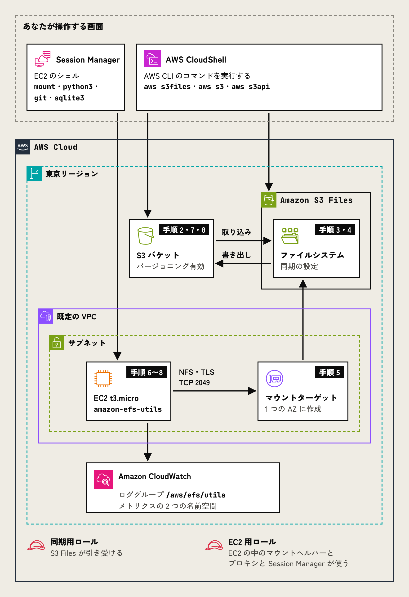
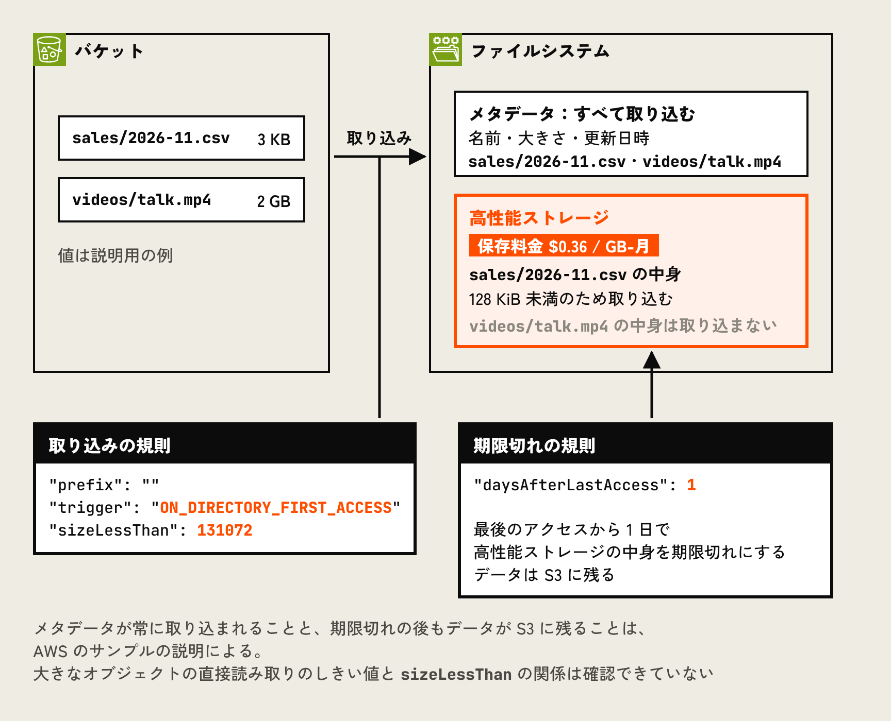
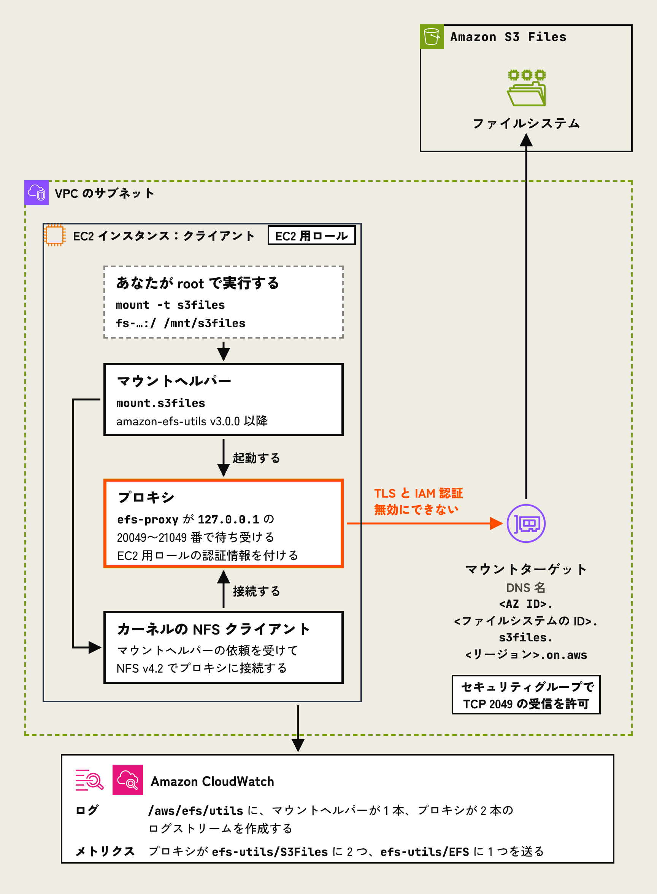
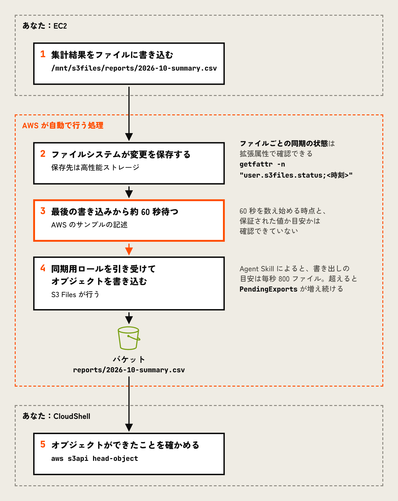
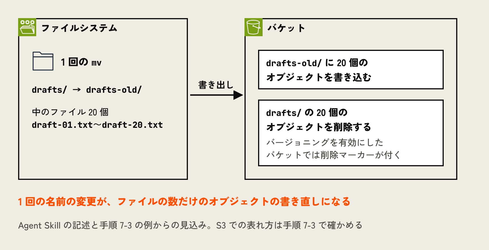
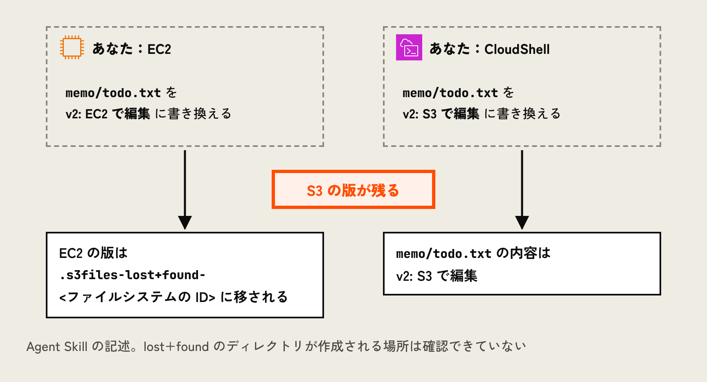

このリポジトリは AWS Deep Cuts の、Amazon S3 Files に関するハンズオンコンテンツです。

<!-- TODO: 記事の公開後に、次の行のリンクを有効にする -->
<!-- Amazon S3 Files の解説記事(Qiita)は[こちら]() -->

解説記事の原稿は [article/amazon-s3-files.md](./article/amazon-s3-files.md) にあります。

> **Note**: Amazon S3 Files は、S3 のバケットに保存したデータを、サーバーからファイルとして読み書きできるようにするサービスです。AWS CLI の変更履歴によると、Amazon S3 Files の API は 2026 年 4 月 7 日に公開されました。以降、Amazon S3 Files を S3 Files と書きます。このハンズオンは、ブラウザから AWS CLI のコマンドを実行できる AWS CloudShell と、1 台の EC2 インスタンスを使って、東京リージョン `ap-northeast-1` で実施します。
> - AWS CLI は、`aws s3files` コマンドに対応した 2.34.26 以降が必要です。CloudShell の AWS CLI は最新版とは限らないため、[前提条件](#前提条件)の手順でバージョンを確認してください。
> - S3 Files をファイルとして使うには、Linux のサーバーで root の権限のコマンドを実行する必要があります。CloudShell でこれができるかは確かめていないため、このハンズオンでは EC2 インスタンスを使います。EC2 インスタンスのシェルは、ブラウザから Session Manager で開きます。Session Manager は、ブラウザから EC2 インスタンスのシェルを開ける AWS Systems Manager の機能です。

<!-- 要確認: What's New で S3 Files の発表日と、一般提供かプレビューかを確かめ、Note に書く -->

> ⚠️ **コストに関する注意**
>
> S3 Files のファイルシステムは、ファイルとして読み書きされたデータを、バケットとは別の高性能ストレージに保存します。高性能ストレージにデータがある間は保存料金がかかり、ファイルシステムへの書き込みと読み取りにも料金がかかります。バケットには、通常の S3 の料金がかかります。
>
> このハンズオンでは、EC2 インスタンスを 1 台起動します。EC2 インスタンスが稼働している間は、EC2 インスタンス・パブリック IPv4 アドレス・EBS ボリュームの料金がかかります。消し忘れたときの費用の上限を決めるため、`setup.sh` は、EC2 インスタンスが起動から 4 時間で自動で終了するように設定します。
>
> | 放置期間 | 概算コストの上限 |
> | --- | --- |
> | 1日 | 約 **$0.34**（約 54 円） |
> | 1週間 | 約 **$0.42**（約 67 円） |
>
> この金額は、AWS Price List に載っている要素から見積もった、手順どおりに進めた場合の上限です。次の条件で計算し、1 ドル 160 円で換算しています。内訳は [費用の見積もり](#費用の見積もり) にあります。
>
> - EC2 インスタンスは、起動から最長 4 時間で自動で終了します。EC2 インスタンス・パブリック IPv4 アドレス・EBS ボリューム・CloudWatch のメトリクスの料金は、最長 4 時間分とします。
> - EC2 インスタンスのルートボリュームは、8 GB の gp3 とします。実際の大きさは `setup.sh` が表示します。
> - S3 Files への書き込みと読み取りは、それぞれ合計 1 GB までとします。手順で書き込むファイルは合計 10 MB 未満です。
> - 高性能ストレージの保存は最大 1 GB、S3 Standard の保存は古い版を含めて最大 2 GB とします。
> - S3 のリクエストは、PUT などが 20,000 件、GET などが 50,000 件までとします。
>
> マウントターゲットの時間料金があるかは、確かめていません。マウントターゲットは手順 5 で説明します。
>
> **検証が終わったら速やかに後片付けを実施してください。**

<!-- 要確認: 請求で APN1-Files-* の使用タイプと、マウントターゲットの時間料金が無いかを確かめる（s3files-133） -->

# AWS Deep Cutsとは
AWS Deep Cutsは、AWS の最新のサービスやニッチな機能、または高度にアカデミックな知識を要求するサービスなど、多くの人が知らない 『隠れた名曲 = **Deep Cuts**』 を深くまで掘り下げる技術シリーズです。

このようなサービスはWeb情報も少なく、初学者は気軽にキャッチアップできないのが実情です。

そこで AWS Deep Cuts シリーズでは、**前提知識も含めた分かりやすいサービス解説** と **手順通りに進めれば誰でも再現できるハンズオン** を提供します！

# ハンズオンのゴール

S3 に保存したデータを EC2 で処理するとき、`aws s3 cp` でデータを EC2 にダウンロードしてから処理し、結果をアップロードし直すことがあります。S3 Files を使うと、この手順を踏まずに、バケットを EC2 のディレクトリにマウントして、ファイルとして読み書きできます。マウントとは、ネットワークの先にあるストレージを、サーバーのディレクトリにつないで、ファイルとして読み書きできるようにすることです。

S3 Files では、マウントした後も、データの正しい版として扱う保存場所はバケットです。このような保存場所を、正本と呼びます。このハンズオンでは、AWS CLI のコマンドを 1 つずつ実行しながら、S3 Files の次の特徴を自分の目で確かめます。

| 確かめる特徴 | 手順 |
| --- | --- |
| S3 にあるデータを、ダウンロードの操作をせずにファイルとして読める | 2・6 |
| マウントの通信は EC2 の中のプロキシを通り、TLS と IAM 認証が付く。プロキシはログとメトリクスを CloudWatch に送る | 6 |
| ファイルとして書いた内容は、しばらくしてから S3 のオブジェクトになる | 7-1 |
| S3 の API で書いた内容は、ファイルとしても読めるようになる | 7-2 |
| 名前の変更は、S3 ではオブジェクトの書き直しになる | 7-3 |
| 両方から同時に書き換えると、S3 の版が残る | 7-4 |

手順 8 では応用として、git と SQLite がこのファイルシステムの上で動くかを試します。

表の用語は、各手順で説明します。仕組みの全体は解説記事で説明しています。先に記事の「Amazon S3 Filesとは？」と「仕組み」を読んでおくと、各手順で何を確かめているのかが分かりやすくなります。

# ハンズオン手順

以降の手順は、ハンズオン用に用意した AWS アカウントで実施してください。

## 構築するアーキテクチャ



このハンズオンでは、CloudShell と EC2 インスタンスのシェルという 2 つの画面を使います。コマンドの前の【CloudShell】【EC2】の札は、そのコマンドを実行する画面を表します。図の箱の右上の「手順 2」などの札は、ハンズオンの手順の番号です。

- あなたは CloudShell から `aws s3files` のコマンドを実行し、ファイルシステム・同期の設定・マウントターゲットを作成します。マウントターゲットは、VPC の中のサーバーがファイルシステムをマウントするための接続先で、手順 5 で詳しく説明します。CLI のコマンドの名前は、API の名前に対応しています。たとえば `create-file-system` コマンドは、`CreateFileSystem` API を呼び出します。
- あなたは CloudShell から `aws s3` と `aws s3api` のコマンドを実行し、バケットのオブジェクトを読み書きします。
- あなたはブラウザの Session Manager で EC2 インスタンスのシェルを開き、ファイルシステムをマウントして、ファイルを読み書きします。ファイルシステムをマウントして使う計算資源を、クライアントと呼びます。このハンズオンのクライアントは、EC2 インスタンスです。
- EC2 インスタンスは、暗号化した通信でマウントターゲットに接続し、ファイルシステムをマウントします。EC2 インスタンスの中で動くプログラムは、ログとメトリクスを CloudWatch に送ります。EC2 インスタンスの中の仕組みは、手順 6 で説明します。
- S3 Files は、同期用ロールを引き受けて、ファイルシステムとバケットの間でデータを同期します。同期とは、ファイルシステムとバケットの間で、変更を互いに反映することです。同期用ロールは手順 1 で説明します。

## 前提条件

- AWS アカウントがあること。2025 年 7 月以降に作成したアカウントで無料プランを選んだ場合に S3 Files を使えるかは確かめていないため、有料プランのアカウントを想定しています。
  <!-- 要確認: 無料プランのアカウントで S3 Files のファイルシステムを作成できるか（s3files-022） -->
- AWS CloudShell を **東京リージョン** で開くこと
- AWS CLI が 2.34.26 以降であること。次のコマンドで確認します。

  【CloudShell】

  ```bash
  aws --version
  aws s3files list-file-systems --generate-cli-skeleton input > /dev/null 2>&1 && echo "OK: このまま進めます" || echo "NG: AWS CLI を更新してください"
  ```

  2 つ目のコマンドで `NG: AWS CLI を更新してください` と表示された場合は、AWS CLI が古いため、次の手順で更新してください。

  <details>
  <summary>AWS CLI の最新版をホームディレクトリにインストールする手順</summary>

  CloudShell の AWS CLI は、最新版より数バージョン古いことがあります。CloudShell のホームディレクトリは次回以降のセッションでも残るため、ここに最新版をインストールします。

  【CloudShell】

  ```bash
  curl -sS https://awscli.amazonaws.com/awscli-exe-linux-x86_64.zip -o /tmp/awscliv2.zip
  unzip -q -o /tmp/awscliv2.zip -d /tmp
  /tmp/aws/install --install-dir "$HOME/.local/aws-cli" --bin-dir "$HOME/.local/bin" --update
  export PATH="$HOME/.local/bin:$PATH"
  aws --version
  ```

  `export PATH=...` の行は、CloudShell のタブを新しく開くたびに実行してください。
  </details>

- 東京リージョンに既定の VPC があり、既定の VPC の DNS 解決と DNS ホスト名が両方とも有効であること。S3 Files のマウントには、この 2 つの設定が必要です。`setup.sh` が確かめ、満たしていない場合は止まります。

  > ⚠️ **既定の VPC が無い場合**
  >
  > 既定の VPC を削除したアカウントや、もとから持たないアカウントでは、`setup.sh` は [2/8] で止まります。次のどちらかを選んでください。
  >
  > - **既存の VPC とパブリックサブネットを指定する**：環境変数 `DEEPCUTS_VPC_ID` と `DEEPCUTS_SUBNET_ID` を両方付けて、`setup.sh` を実行します。サブネットは、0.0.0.0/0 の経路がインターネットゲートウェイに向いているパブリックサブネットにします。VPC の DNS 解決と DNS ホスト名が両方とも有効であることも必要です。`setup.sh` がこれらを確かめます。
  >
  >   ```bash
  >   DEEPCUTS_VPC_ID=<VPC の ID> DEEPCUTS_SUBNET_ID=<サブネットの ID> bash ./setup.sh
  >   ```
  >
  > - **既定の VPC を作成する**：`aws ec2 create-default-vpc --region ap-northeast-1` で作成してから、`setup.sh` を実行します。**作成した既定の VPC は、`cleanup.sh` では削除されません。** 不要になったら、ハンズオンの後にあなたが削除してください。
  >
  > どちらの場合も、`setup.sh` と `cleanup.sh` は、VPC とサブネットを作成も削除もしません。
- CloudShell を開いた IAM ユーザーまたは IAM ロールに、S3 Files・S3・IAM・EC2・Systems Manager の操作権限と、CloudWatch・CloudWatch Logs・EventBridge の参照の権限があること。IAM の権限には、ロールとインスタンスプロファイルの作成と、ロールを AWS のサービスに渡す `iam:PassRole` が含まれます。`AdministratorAccess` 相当の権限で実施するのが簡単です。EC2 インスタンスの中のプログラムがログとメトリクスを送る権限は、あなたではなく、`setup.sh` が作成する EC2 用ロールに付けます。

<details>
<summary>最小権限に近い IAM ポリシーの例</summary>

CloudShell を使う権限は、このポリシーとは別に必要です。たとえば AWS 管理ポリシーの `AWSCloudShellFullAccess` をアタッチします。S3 Files のアクションは、個々のアクションの名前をすべて確かめていないため、`s3files:*` としています。

```json
{
  "Version": "2012-10-17",
  "Statement": [
    {
      "Sid": "S3Files",
      "Effect": "Allow",
      "Action": "s3files:*",
      "Resource": "*"
    },
    {
      "Sid": "HandsOnBucket",
      "Effect": "Allow",
      "Action": [
        "s3:CreateBucket", "s3:PutBucketPublicAccessBlock", "s3:PutBucketVersioning", "s3:ListBucket", "s3:ListBucketVersions",
        "s3:GetObject", "s3:GetObjectVersion", "s3:PutObject", "s3:DeleteObject", "s3:DeleteObjectVersion", "s3:DeleteBucket"
      ],
      "Resource": ["arn:aws:s3:::aws-deepcuts-s3files-*", "arn:aws:s3:::aws-deepcuts-s3files-*/*"]
    },
    {
      "Sid": "Roles",
      "Effect": "Allow",
      "Action": [
        "iam:CreateRole", "iam:GetRole", "iam:UpdateAssumeRolePolicy", "iam:TagRole", "iam:PassRole",
        "iam:PutRolePolicy", "iam:GetRolePolicy", "iam:DeleteRolePolicy", "iam:ListRolePolicies",
        "iam:AttachRolePolicy", "iam:DetachRolePolicy", "iam:ListAttachedRolePolicies", "iam:DeleteRole"
      ],
      "Resource": ["arn:aws:iam::*:role/aws-deepcuts-s3files-sync-role", "arn:aws:iam::*:role/aws-deepcuts-s3files-ec2-role"]
    },
    {
      "Sid": "InstanceProfile",
      "Effect": "Allow",
      "Action": [
        "iam:CreateInstanceProfile", "iam:GetInstanceProfile", "iam:TagInstanceProfile",
        "iam:AddRoleToInstanceProfile", "iam:RemoveRoleFromInstanceProfile", "iam:DeleteInstanceProfile"
      ],
      "Resource": "arn:aws:iam::*:instance-profile/aws-deepcuts-s3files-ec2-profile"
    },
    {
      "Sid": "Ec2",
      "Effect": "Allow",
      "Action": [
        "ec2:DescribeVpcs", "ec2:DescribeVpcAttribute", "ec2:DescribeSubnets", "ec2:DescribeInstanceTypeOfferings",
        "ec2:DescribeSecurityGroups", "ec2:CreateSecurityGroup", "ec2:AuthorizeSecurityGroupIngress", "ec2:DeleteSecurityGroup",
        "ec2:RunInstances", "ec2:DescribeInstances", "ec2:TerminateInstances", "ec2:CreateTags",
        "ec2:DescribeVolumes", "ec2:DescribeNetworkInterfaces"
      ],
      "Resource": "*"
    },
    {
      "Sid": "SystemsManager",
      "Effect": "Allow",
      "Action": [
        "ssm:GetParameters", "ssm:DescribeInstanceInformation",
        "ssm:StartSession", "ssm:ResumeSession", "ssm:TerminateSession"
      ],
      "Resource": "*"
    },
    {
      "Sid": "LogsMetricsAndRules",
      "Effect": "Allow",
      "Action": [
        "logs:DescribeLogGroups", "logs:DescribeLogStreams", "logs:GetLogEvents", "logs:FilterLogEvents",
        "logs:DeleteLogGroup", "logs:DeleteLogStream",
        "cloudwatch:ListMetrics", "cloudwatch:GetMetricData",
        "events:ListRules", "events:DescribeRule", "events:ListTargetsByRule"
      ],
      "Resource": "*"
    },
    {
      "Sid": "ConsoleRead",
      "Effect": "Allow",
      "Action": ["sts:GetCallerIdentity", "iam:ListRoles", "s3:ListAllMyBuckets", "s3:GetBucketLocation"],
      "Resource": "*"
    }
  ]
}
```

`ssm:GetParameters` は、`setup.sh` が EC2 インスタンスを起動するときに、Amazon Linux 2023 の最新の AMI の ID を Systems Manager のパラメータから取得するために使います。トラブルシューティングの「EventBridge のルールが残る場合」の手順を行うときは、`events:RemoveTargets` と `events:DeleteRule` も必要です。
</details>

<!-- 要確認: s3files:CreateFileSystem で同期用ロールを渡すときに iam:PassRole が必要か。最小権限の例で S3 Files のハンズオンを最後まで実行できるか -->

以降、【CloudShell】の札が付いたコマンドは、東京リージョンで開いた [CloudShell](https://docs.aws.amazon.com/cloudshell/latest/userguide/welcome.html) で実行してください。

## １．事前準備

このハンズオンでは、S3 バケット、IAM ロール 2 つ、セキュリティグループ 2 つ、EC2 インスタンス 1 台を使います。これらの作成はハンズオンの本質ではないため、`setup.sh` で作成します。

### 1-1. setup.sh を実行する

【CloudShell】

```bash
# このリポジトリをクローン
git clone https://github.com/AWS-Deep-Cuts/amazon-s3-files
cd amazon-s3-files/hands-on

# セットアップスクリプトの実行
bash ./setup.sh

# 以下の文言が表示されればセットアップ成功です
# ✅ セットアップが完了しました！
```

`setup.sh` は、次のリソースを作成します。

| リソース | 名前 | 用途 |
| --- | --- | --- |
| S3 バケット | `aws-deepcuts-s3files-<アカウント ID>-<日時>` | ファイルシステムとしてマウントするバケット。バージョニングを有効にする |
| 同期用ロール | `aws-deepcuts-s3files-sync-role` | S3 Files が引き受ける。バケットの読み書きと、名前が `DO-NOT-DELETE-S3-Files` で始まる EventBridge のルールの管理を許可する |
| EC2 用ロールとインスタンスプロファイル | `aws-deepcuts-s3files-ec2-role`、`aws-deepcuts-s3files-ec2-profile` | EC2 インスタンスの中で、手順 6 でインストールするマウント用のプログラムと、Session Manager が使う。マウント、バケットの読み取り、ログとメトリクスの送信を許可する |
| クライアントのセキュリティグループ | `aws-deepcuts-s3files-client-sg` | EC2 インスタンスに付ける。受信の規則は無い |
| マウントターゲットのセキュリティグループ | `aws-deepcuts-s3files-mount-target-sg` | 手順 5 でマウントターゲットに付ける。TCP 2049 の受信を、クライアントのセキュリティグループからだけ許可する |
| EC2 インスタンス | `aws-deepcuts-s3files-client` | t3.micro、Amazon Linux 2023、x86_64。既定の VPC のサブネット（`DEEPCUTS_VPC_ID` と `DEEPCUTS_SUBNET_ID` を指定した場合は、そのサブネット）に、パブリック IPv4 アドレス付きで起動する。CPU クレジットの方式を、T3 の既定の `unlimited` から `standard` に変えて起動する。起動から 4 時間で自動で終了する |

`setup.sh` は、2 つの IAM ロールを作成します。1 つ目の同期用ロールは、S3 Files が、ファイルシステムとバケットの間でデータを読み書きするときに引き受ける IAM ロールです。IAM ロールを引き受けるとは、AWS のサービスなどが、IAM ロールに付与された権限を一時的に使って AWS のリソースを操作することです。同期用ロールには、EventBridge のルールを管理する権限も付けます。EventBridge は、AWS のサービスで起きた変更などのイベントを、規則に従って他のサービスに届けるサービスです。同期用ロールの中身は、手順 1-2 と手順 1-3 で確かめます。

2 つ目の EC2 用ロールは、インスタンスプロファイルで EC2 インスタンスに関連付けます。インスタンスプロファイルは、EC2 インスタンスに IAM ロールを関連付ける設定です。EC2 インスタンスの中のプログラムは、EC2 用ロールの権限でファイルシステムをマウントし、ログとメトリクスを送ります。

バケットは、バージョニングを有効にして作成します。バージョニングを有効にしたバケットでは、オブジェクトを上書きしたり削除したりしても、古い版がバケットに残ります。そのため、手順 7 で、名前の変更や競合の跡をバケットの古い版で確かめられます。

このハンズオンでは、AWS が公開している 2 つの資料を出典として使います。1 つ目は、AWS が aws-samples で公開している、S3 Files を Terraform で作成するサンプルです。以降、このサンプルを AWS のサンプルと呼びます。AWS のサンプルは AWS の公式ドキュメントではありませんが、AWS が公開しているコードと説明です。2 つ目は Agent Skill です。AWS は、AWS のサービスの使い方をまとめ、AI エージェントが読み込んで使えるようにした文書を、Agent Skill として公開しています。

このハンズオンの同期用ロールの設定は、AWS のサンプルと同じにしています。バケットのバージョニングを有効にするのは、AWS のサンプルが前提条件に挙げているためです。バージョニングが必須かどうかは確かめていません。

EC2 インスタンスは、起動から 4 時間で自動で終了します。消し忘れたときの費用の上限を決めるためです。`setup.sh` は、EC2 インスタンスの起動時に実行するスクリプトであるユーザーデータで、`shutdown -h +240` を実行します。さらに、OS からシャットダウンしたときの動作を `terminate` にしているため、OS が 240 分後にシャットダウンすると、EC2 インスタンスが終了します。4 時間を過ぎた場合は、`cleanup.sh` と `setup.sh` を実行し直してください。

`setup.sh` は、作成したリソースの名前と ID を `resource-ids.env` に保存しました。次のコマンドでこのファイルを読み込むと、以降のコマンドで変数として使えます。

【CloudShell】

```bash
source ./resource-ids.env
cat resource-ids.env
```

| 変数 | 中身 | 使う手順 |
| --- | --- | --- |
| `REGION` | リージョン `ap-northeast-1` | すべて |
| `ACCOUNT_ID` | AWS アカウントの ID | — |
| `BUCKET_NAME` | S3 バケットの名前 | 2・3・7・8 |
| `SYNC_ROLE_ARN` | 同期用ロールの ARN | 3 |
| `VPC_ID`・`SUBNET_ID`・`AZ_NAME` | 既定の VPC（または指定した VPC）の ID と、EC2 インスタンスを起動したサブネットの ID と AZ の名前 | 5 |
| `CLIENT_SG_ID`・`MT_SG_ID` | クライアントとマウントターゲットのセキュリティグループの ID | 5 |
| `INSTANCE_ID` | EC2 インスタンスの ID | 6 |

ARN（Amazon Resource Name）は、AWS のリソースを一意に指す名前です。AZ は、アベイラビリティーゾーン（Availability Zone）の略です。以降の手順では、作成したファイルシステムの ID `FS_ID` を手順 3 で、マウントターゲットの ID `MT_ID`・AZ ID `AZ_ID`・ネットワークインターフェイスの ID `MT_ENI_ID` を手順 5 で、このファイルに追記します。

`cat` の出力には、この表に無い `SYNC_ROLE_NAME`・`EC2_ROLE_NAME`・`INSTANCE_PROFILE_NAME`・`EC2_POLICY_NAME`・`CLIENT_SG_NAME`・`MT_SG_NAME`・`EFS_UTILS_LOG_GROUP_EXISTED` も表示されます。これらは `cleanup.sh` がリソースを削除するときに使う値で、以降の手順のコマンドでは使いません。

> **Note**: CloudShell は、操作しない時間が続くとセッションが終了し、変数が消えます。その場合は、次の 2 行を実行してから続きの手順に進んでください。
>
> ```bash
> cd ~/amazon-s3-files/hands-on
> source ./resource-ids.env
> ```
>
> 前提条件で AWS CLI をホームディレクトリにインストールした場合は、`export PATH="$HOME/.local/bin:$PATH"` も実行します。

### 1-2. 同期用ロールの信頼ポリシーを表示する

S3 Files は、同期用ロールを引き受けてバケットを読み書きします。どの AWS のサービスがこのロールを引き受けられるかは、ロールの信頼ポリシーで決まります。信頼ポリシーは、誰がこのロールを引き受けられるかを決める JSON の文書です。IAM に、同期用ロールの信頼ポリシーを返すよう依頼します。

【CloudShell】

```bash
aws iam get-role --role-name aws-deepcuts-s3files-sync-role \
  --query Role.AssumeRolePolicyDocument
```

出力の形の例は次のとおりです。アカウント ID などの値は、環境ごとに異なります。

```json
{
    "Version": "2012-10-17",
    "Statement": [
        {
            "Effect": "Allow",
            "Principal": { "Service": "elasticfilesystem.amazonaws.com" },
            "Action": "sts:AssumeRole",
            "Condition": {
                "StringEquals": { "aws:SourceAccount": "111122223333" },
                "ArnLike": { "aws:SourceArn": "arn:aws:s3files:ap-northeast-1:111122223333:file-system/*" }
            }
        }
    ]
}
```

| キー | 値 | 意味 |
| --- | --- | --- |
| `Principal.Service` | `elasticfilesystem.amazonaws.com` | このロールを引き受けられる AWS のサービス。AWS のサンプルでは、S3 Files のロールでも、EFS のサービスの名前を書いている |
| `Action` | `sts:AssumeRole` | ロールを引き受ける操作 |
| `Condition` の `aws:SourceAccount` | あなたのアカウント ID | あなたのアカウントのリソースのために引き受けるときだけ許可する |
| `Condition` の `aws:SourceArn` | `arn:aws:s3files:<リージョン>:<アカウント ID>:file-system/*` | あなたのアカウントの S3 Files のファイルシステムのために引き受けるときだけ許可する |

2 つの条件は、他のアカウントのリソースのために、このロールが使われないようにするためのものです。

### 1-3. EventBridge の権限を表示する

同期用ロールには、`s3-access` と `eventbridge-access` という 2 つのインラインポリシーがあります。インラインポリシーは、1 つのロールに直接埋め込んだポリシーです。IAM に、`eventbridge-access` の中身を返すよう依頼します。

【CloudShell】

```bash
aws iam get-role-policy --role-name aws-deepcuts-s3files-sync-role \
  --policy-name eventbridge-access --query PolicyDocument
```

出力には、2 つのステートメントがあります。1 つ目の `EventBridgeManage` は、名前が `DO-NOT-DELETE-S3-Files` で始まるルールの作成・削除・有効化・無効化と、ターゲットの追加と削除を許可します。ただし、条件 `events:ManagedBy` が `elasticfilesystem.amazonaws.com` のとき、つまりルールを管理するサービスが EFS の名前のときだけです。2 つ目の `EventBridgeRead` は、ルールの参照を許可します。どちらも、AWS のサンプルの `environments/dev/main.tf` と同じ中身です。

AWS のサンプルのこの権限から、S3 Files は、S3 側の変更を検知するために EventBridge のルールを使うと読めます。公式の説明は確かめていません。手順 3-3 で、実際にルールが作成されるかを確かめます。

<details>
<summary>もう 1 つのインラインポリシー s3-access を表示するコマンド</summary>

【CloudShell】

```bash
aws iam get-role-policy --role-name aws-deepcuts-s3files-sync-role \
  --policy-name s3-access --query PolicyDocument
```

バケットの一覧の取得と、バケットの中のオブジェクトの読み取り・書き込み・削除を許可しています。
</details>

<!-- 画面写真: IAM コンソールの aws-deepcuts-s3files-sync-role の「信頼関係」タブ。信頼されたエンティティの elasticfilesystem.amazonaws.com と、条件の aws:SourceArn を枠で囲む -->

> **この手順で確かめること**
> - **やること**: 手順 1-2 と手順 1-3 の出力を確認します。続けて、IAM コンソールの左のメニューから「ロール」を選び、`aws-deepcuts-s3files-sync-role` を開いて「信頼関係」タブを確認します。
> - **期待する結果**: 手順 1-2 の `Principal` は `elasticfilesystem.amazonaws.com` です。条件に、`aws:SourceArn` が `arn:aws:s3files:ap-northeast-1:<アカウント ID>:file-system/*` に一致すること、`aws:SourceAccount` があなたのアカウント ID であることが書かれています。コンソールの「信頼関係」タブにも、同じ JSON が表示されています。手順 1-3 の出力には、`events:ManagedBy` の条件が付いたステートメントがあります。
> - **ここから分かること**: このロールを引き受けるのは、あなたではなく AWS のサービスです。プリンシパルの名前は `s3files.amazonaws.com` ではなく、EFS のサービスの名前です。このハンズオンでは、AWS のサンプルと同じ設定にしています。条件によって、このロールは、あなたのアカウントの S3 Files のファイルシステムのためだけに使われます。

## ２．売上の CSV を S3 にアップロードする

S3 に保存したデータの単位をオブジェクト、オブジェクトの名前をキーと呼びます。たとえば `sales/2026-10.csv` はキーの例で、`/` もキーの一部です。S3 の一般的なバケットを汎用バケットと呼び、S3 Files が使うのはこの種類のバケットです。以降、単にバケットと書きます。

この手順では、店舗ごとの売上をまとめた CSV が S3 にある状態を用意します。ファイルシステムを作成する前に S3 に保存しておくことで、手順 6 で、すでに S3 にあるデータをファイルとして読みます。

`data/sales-2026-10.csv` は、このリポジトリに含めた説明用のデータです。列は `date`・`store`・`item`・`amount` の 4 つで、2026 年 10 月 1 日から 31 日までの 31 日分を、`tokyo`・`osaka`・`fukuoka` の 3 店舗について 1 行ずつ記録しています。データの行は 93 行で、先頭に見出しの行があります。

【CloudShell】

```bash
head -4 data/sales-2026-10.csv
aws s3 cp data/sales-2026-10.csv "s3://${BUCKET_NAME}/sales/2026-10.csv" --region "${REGION}"
aws s3 ls "s3://${BUCKET_NAME}/" --recursive --region "${REGION}"
```

`head -4` の出力は次のとおりです。

```text
date,store,item,amount
2026-10-01,tokyo,sandwich,38630
2026-10-01,osaka,cake,21040
2026-10-01,fukuoka,coffee,25320
```

<!-- 画面写真: S3 コンソールのバケット aws-deepcuts-s3files-... のオブジェクト一覧で sales/ を開いた画面。2026-10.csv を枠で囲む -->

> **この手順で確かめること**
> - **やること**: S3 コンソールの「汎用バケット」の一覧から `aws-deepcuts-s3files-` で始まるバケットを開き、`sales/` を開きます。
> - **期待する結果**: `2026-10.csv` が表示されています。
> - **ここから分かること**: このオブジェクトは、ファイルシステムが無い状態で S3 に保存したデータです。コンソールでは `sales/` がフォルダのように表示されますが、オブジェクトのキーは `sales/2026-10.csv` という 1 つの名前です。

## ３．ファイルシステムを作成する

S3 Files では、バケットの全体か、バケットの中のプレフィックスを対象にしてファイルシステムを作成します。プレフィックスは、キーの先頭の共通部分です。たとえば `sales/` は、`sales/2026-10.csv` のプレフィックスです。S3 Files が作成するファイルシステムは、対象のバケットかプレフィックスを、複数のサーバーからファイルとして読み書きできるようにする共有ファイルシステムです。以降、単にファイルシステムと書くときは、S3 Files のファイルシステムを指します。ディレクトリとファイルで読み書きする OS の一般的な仕組みを指すときは、OS のファイルシステムと書きます。

### 3-1. 作成を依頼する

`create-file-system` で、S3 Files にファイルシステムの作成を依頼します。

【CloudShell】

```bash
source ./resource-ids.env
if [[ -n "${FS_ID:-}" ]]; then
  echo "ファイルシステムは作成済みです。新しく作成せず、この ID を使います: ${FS_ID}"
else
  FS_ID=$(aws s3files create-file-system \
    --region "${REGION}" \
    --bucket "arn:aws:s3:::${BUCKET_NAME}" \
    --role-arn "${SYNC_ROLE_ARN}" \
    --tags key=Name,value=aws-deepcuts-s3files \
    --query fileSystemId --output text)
  [[ "${FS_ID}" == fs-* ]] && echo "FS_ID=\"${FS_ID}\"" >> resource-ids.env
fi
echo "${FS_ID}"
```

`resource-ids.env` に `FS_ID` がすでにあれば、新しく作成せず、その ID を使います。手順 3 をやり直したときに、ファイルシステムが 2 つ作成されないようにするためです。`[[ ... ]] &&` の行は、ID が `fs-` で始まるとき、つまり作成の依頼に成功したときだけ、ID を `resource-ids.env` に追記します。

| パラメータ | 指定した値 | 意味 |
| --- | --- | --- |
| `--bucket` | バケットの ARN | ファイルシステムとして読み書きできるようにするバケット。存在していて、同じリージョンにあること |
| `--role-arn` | 同期用ロールの ARN | S3 Files が引き受けるロール。必須 |
| `--tags` | `Name` が `aws-deepcuts-s3files` | `Name` タグの値が、ファイルシステムの名前になる |

指定していないパラメータは次のとおりです。`--prefix` を省くと、バケット全体が対象になります。`--kms-key-id` を省いても、データは既定で暗号化されます。`--accept-bucket-warning` は、バケットの構成についての警告を受け入れるためのものです。Terraform の AWS プロバイダーの文書は、約 1,200 万個のオブジェクトを含むプレフィックスを、警告が出る例に挙げています。

応答の JSON のキーは、`fileSystemId` のように小文字で始まります。そのため、`--query` にも小文字で始まるキーを指定します。

バケット・プレフィックス・同期用ロール・KMS キーは、作成した後には変えられません。変えるには、ファイルシステムを作成し直します。このハンズオンで作成し直したい場合は、`cleanup.sh` で後片付けをしてから、`setup.sh` からやり直してください。

### 3-2. 作成の完了を待つ

`create-file-system` は、作成を依頼するだけで、作成の完了を待たずに終わります。S3 Files の API には、完了を待つためのコマンドがありません。次のコマンドは、ファイルシステムの状態を 15 秒ごとに表示し、状態が `creating` 以外になったら終了します。最長 15 分で止まります。

【CloudShell】

```bash
for i in $(seq 1 60); do
  STATUS=$(aws s3files get-file-system --file-system-id "${FS_ID}" \
    --region "${REGION}" --query status --output text)
  echo "$(date +%H:%M:%S) ${STATUS}"
  [[ "${STATUS}" == "creating" ]] || break
  sleep 15
done
```

表示される時刻は、CloudShell の既定のタイムゾーンである協定世界時（UTC）です。日本時間は、この時刻に 9 時間を足した時刻です。状態が `available` になったら、ファイルシステムの詳細を表示します。

【CloudShell】

```bash
aws s3files get-file-system --file-system-id "${FS_ID}" --region "${REGION}"
```

出力には、`fileSystemId`・`fileSystemArn`・`bucket`・`status`・`roleArn`・`name`・`creationTime` などのキーがあります。値は環境ごとに異なります。

15 分たっても `creating` のままの場合は、次のコマンドで状態の説明を表示し、[トラブルシューティング](#トラブルシューティング)を確認してください。

【CloudShell】

```bash
aws s3files get-file-system --file-system-id "${FS_ID}" --region "${REGION}" \
  --query statusMessage --output text
```

### 3-3. EventBridge のルールを確認する

手順 1-3 で確認した同期用ロールの権限から、S3 Files は、名前が `DO-NOT-DELETE-S3-Files` で始まるルールを作成すると読めます。EventBridge に、その名前で始まるルールの一覧を返すよう依頼します。

【CloudShell】

```bash
aws events list-rules --name-prefix DO-NOT-DELETE-S3-Files --region "${REGION}" \
  --query 'Rules[].[Name, ManagedBy, State]' --output table
```

表の列は、左からルールの名前、ルールを管理するサービス、ルールの状態です。2026 年 11 月の検証では、ファイルシステムが `available` になった時点で、名前が `DO-NOT-DELETE-S3-Files-c-` の後ろに 13 桁の数字が続くルールが 1 つ作成されていました。`ManagedBy` は `elasticfilesystem.amazonaws.com`、状態は `ENABLED` でした。このルールは、ファイルシステムを削除すると、一緒に無くなりました。

S3 Files のファイルシステムの一覧は、S3 コンソールの左のメニューの「ファイル」から「ファイルシステム」を選ぶと開けます。

<!-- 画面写真: S3 コンソールの「ファイル」→「ファイルシステム」の一覧。aws-deepcuts-s3files と状態を枠で囲む -->
<!-- 画面写真: EventBridge コンソールの「ルール」の一覧。DO-NOT-DELETE-S3-Files で始まるルールを枠で囲む（作成される場合） -->

> **この手順で確かめること**
> - **やること**: 手順 3-2 の `get-file-system` の出力の `status`・`bucket`・`roleArn`・`name` を確認します。続けて、手順 3-3 で EventBridge のルールの一覧を表示したコマンドの出力を確認します。さらに、S3 コンソールの左のメニューの「ファイル」から「ファイルシステム」を選び、ファイルシステムの一覧を開きます。EventBridge コンソールの「ルール」も開き、検索欄に `DO-NOT-DELETE` と入力して絞り込みます。
> - **期待する結果**: `status` は `available`、`bucket` は手順 2 のバケットの ARN、`roleArn` は同期用ロールの ARN、`name` は `aws-deepcuts-s3files` です。ファイルシステムの一覧では、`aws-deepcuts-s3files` のステータスが「利用可能」です。EventBridge のルールは、名前が `DO-NOT-DELETE-S3-Files` で始まり、`ManagedBy` が `elasticfilesystem.amazonaws.com` のものが 1 つ表示されます。ルールが表示されない場合も、手順はそのまま続けられます。
> - **ここから分かること**: `create-file-system` は作成を依頼するだけで、作成は AWS の中で非同期に進みます。S3 Files には完了を待つコマンドが無いため、状態を自分で確かめます。ファイルシステムは、バケットとは別の AWS のリソースで、バケットと同期用ロールに結び付いています。

<!-- 2026-11 の検証で確かめた: ルールはファイルシステムの作成で 1 つ作成され、ManagedBy は elasticfilesystem.amazonaws.com。ファイルシステムの削除とともに無くなった（s3files-082） -->

## ４．同期の設定を確かめて変える

ファイルシステムは、バケットのオブジェクトをファイルとして読めるようにするために、オブジェクトの情報をファイルシステムに反映します。バケットの内容をファイルシステムに反映することを、取り込みと呼びます。取り込むものは、メタデータと中身に分けられます。メタデータは、オブジェクトの中身以外の情報で、名前・大きさ・更新日時などです。中身は、オブジェクトのデータそのものです。

取り込んだ中身は、ファイルシステムの高性能ストレージに保存されます。高性能ストレージは、ファイルシステムが、取り込んだ中身とファイルとして書き込まれた中身を、バケットとは別に保存する場所です。中身が高性能ストレージにある間は、保存料金がかかります。

どのオブジェクトの中身を、いつ取り込み、いつ高性能ストレージから期限切れにするかは、同期の設定で決まります。同期の設定は、取り込みの規則と期限切れの規則の組です。この手順では、作成直後の同期の設定を確認し、期限切れの日数を変えます。同期の設定で決まることは、次の図のとおりです。



### 4-1. 作成直後の同期の設定を表示する

【CloudShell】

```bash
aws s3files get-synchronization-configuration --file-system-id "${FS_ID}" --region "${REGION}"
```

作成の直後から、同期の設定はあります。2026 年 11 月の検証では、次の値が表示されました。

```json
{
    "latestVersionNumber": 0,
    "importDataRules": [
        { "prefix": "", "trigger": "ON_DIRECTORY_FIRST_ACCESS", "sizeLessThan": 131072 }
    ],
    "expirationDataRules": [
        { "daysAfterLastAccess": 30 }
    ]
}
```

作成の直後は、バケット全体を対象に、ディレクトリに初めてアクセスしたときに 128 KiB 未満のオブジェクトの中身を取り込む規則が 1 つあり、期限切れは 30 日です。

| キー | 意味 |
| --- | --- |
| `latestVersionNumber` | 同期の設定のバージョンの番号。設定を変えるときに使う |
| `importDataRules` | 取り込みの規則の一覧。1〜10 個 |
| `importDataRules` の `prefix` | 規則を適用するプレフィックス。空の文字列はバケット全体を表す |
| `importDataRules` の `trigger` | 取り込みのきっかけ。`ON_DIRECTORY_FIRST_ACCESS` はディレクトリに初めてアクセスしたとき、`ON_FILE_ACCESS` はファイルにアクセスしたとき |
| `importDataRules` の `sizeLessThan` | この値未満の大きさのオブジェクトだけ、中身を取り込む。単位はバイト |
| `expirationDataRules` | 期限切れの規則。ちょうど 1 個 |
| `expirationDataRules` の `daysAfterLastAccess` | 最後のアクセスから何日で、高性能ストレージの中身を期限切れにするか。1〜365 日 |

<!-- 2026-11 の検証で確かめた: 作成直後から同期の設定があり、値は上のとおり（s3files-070、071）。設定が無い場合のエラーの形は確かめていない -->

### 4-2. 期限切れの日数を 1 日に変える

`put-synchronization-configuration` で、同期の設定を変えるよう S3 Files に依頼します。

【CloudShell】

```bash
SYNC_VERSION=$(aws s3files get-synchronization-configuration --file-system-id "${FS_ID}" \
  --region "${REGION}" --query latestVersionNumber --output text 2>/dev/null)
VERSION_ARGS=()
[[ "${SYNC_VERSION}" =~ ^[0-9]+$ ]] && VERSION_ARGS=(--latest-version-number "${SYNC_VERSION}")

aws s3files put-synchronization-configuration \
  --region "${REGION}" \
  --file-system-id "${FS_ID}" \
  --import-data-rules prefix=,trigger=ON_DIRECTORY_FIRST_ACCESS,sizeLessThan=131072 \
  --expiration-data-rules daysAfterLastAccess=1 \
  "${VERSION_ARGS[@]}"
```

同期の設定がすでにある場合は、そのバージョンの番号を `--latest-version-number` で渡す必要があります。1〜2 行目で、現在の設定のバージョンの番号を取得します。3 行目で、空の配列 `VERSION_ARGS` を用意します。4 行目で、番号が数字のときだけ、`--latest-version-number <番号>` を配列に入れます。最後の行の `"${VERSION_ARGS[@]}"` は、配列の中身を引数として展開します。そのため、番号を取得できなかったときは、何も付きません。

| パラメータ | 指定した値 | 意味 |
| --- | --- | --- |
| `--import-data-rules` | `prefix=` | 空の文字列。バケット全体に適用する |
| | `trigger=ON_DIRECTORY_FIRST_ACCESS` | ディレクトリに初めてアクセスしたときに取り込む |
| | `sizeLessThan=131072` | 131,072 バイト、つまり 128 KiB 未満のオブジェクトだけ、中身を取り込む。AWS のサンプルの値と同じ |
| `--expiration-data-rules` | `daysAfterLastAccess=1` | 最後のアクセスから 1 日で、高性能ストレージの中身を期限切れにする。1 は設定できる最小の値 |
| `--latest-version-number` | 手順 4-1 の番号 | 他の変更と食い違うと `ConflictException` になる |

期限切れの日数を 1 日にするのは、高性能ストレージの保存料金が、東京リージョンで S3 Standard の保存料金の 14.4 倍であるためです。使わないデータを早く期限切れにして、費用を抑える設定を試します。AWS のサンプルの説明によると、期限切れになっても、データはバケットに残ります。

### 4-3. 変更を確かめる

【CloudShell】

```bash
aws s3files get-synchronization-configuration --file-system-id "${FS_ID}" --region "${REGION}"
```

> **この手順で確かめること**
> - **やること**: 手順 4-1 と手順 4-3 の出力を比べます。
> - **期待する結果**: 手順 4-3 の `expirationDataRules` の `daysAfterLastAccess` が `1`、`importDataRules` が指定した 3 つの値になっています。取り込みの規則は作成直後の値と同じため、変わるのは期限切れの日数だけです。`latestVersionNumber` は、手順 4-1 の `0` から `1` に変わります。
> - **ここから分かること**: 同期の設定は、どのオブジェクトの中身を高性能ストレージに取り込み、いつ期限切れにするかを決めます。AWS のサンプルの説明によると、メタデータは、この規則にかかわらず取り込まれます。中身が高性能ストレージにある間は保存料金がかかるため、この設定は費用の設定でもあります。

## ５．マウントターゲットを作成する

マウントターゲットは、特定の AZ と VPC のクライアントがマウントするための、ファイルシステムの接続先です。マウントターゲットは、サブネットを指定して作成し、指定したサブネットで AZ が決まります。マウントターゲットを作成すると、S3 Files が管理するネットワークインターフェイスが、指定したサブネットに作成されます。このネットワークインターフェイスを ENI（elastic network interface）と呼びます。ENI は、VPC のサブネットに作成され、IP アドレスを持つネットワークインターフェイスです。

### 5-1. 作成を依頼する

`create-mount-target` で、S3 Files にマウントターゲットの作成を依頼します。

【CloudShell】

```bash
source ./resource-ids.env
if [[ -n "${MT_ID:-}" ]]; then
  echo "マウントターゲットは作成済みです。新しく作成せず、この ID を使います: ${MT_ID}"
else
  MT_ID=$(aws s3files create-mount-target \
    --region "${REGION}" \
    --file-system-id "${FS_ID}" \
    --subnet-id "${SUBNET_ID}" \
    --security-groups "${MT_SG_ID}" \
    --query mountTargetId --output text)
  [[ "${MT_ID}" == fsmt-* ]] && echo "MT_ID=\"${MT_ID}\"" >> resource-ids.env
fi
echo "${MT_ID}"
```

手順 3-1 と同じく、`resource-ids.env` に `MT_ID` がすでにあれば、新しく作成しません。

| パラメータ | 指定した値 | 意味 |
| --- | --- | --- |
| `--subnet-id` | EC2 インスタンスと同じサブネット | サブネットで AZ が決まる。EC2 インスタンスと同じ AZ にすると、AZ をまたぐ接続にならない |
| `--security-groups` | マウントターゲットのセキュリティグループ | 省くと、VPC の既定のセキュリティグループが付く |

指定していないパラメータは次のとおりです。`--ip-address-type` を省くと、既定の `IPV4_ONLY` になります。`--ipv4-address` を省くと、サブネットから IP アドレスが割り当てられます。

### 5-2. 作成の完了を待つ

次のコマンドは、マウントターゲットの状態を 20 秒ごとに表示し、状態が `creating` 以外になったら終了します。最長 20 分で止まります。AWS のサンプルでは、マウントターゲットの作成に約 5 分かかっています。

【CloudShell】

```bash
for i in $(seq 1 60); do
  STATUS=$(aws s3files get-mount-target --mount-target-id "${MT_ID}" \
    --region "${REGION}" --query status --output text)
  echo "$(date +%H:%M:%S) ${STATUS}"
  [[ "${STATUS}" == "creating" ]] || break
  sleep 20
done
```

状態が `available` になったら、次の手順に進みます。

### 5-3. 詳細を表示して ID を保存する

マウントターゲットの詳細を表示し、AZ ID と ENI の ID を `resource-ids.env` に保存します。続けて、EC2 に、その ENI の情報を返すよう依頼します。

【CloudShell】

```bash
aws s3files get-mount-target --mount-target-id "${MT_ID}" --region "${REGION}"

AZ_ID=$(aws s3files get-mount-target --mount-target-id "${MT_ID}" \
  --region "${REGION}" --query availabilityZoneId --output text)
MT_ENI_ID=$(aws s3files get-mount-target --mount-target-id "${MT_ID}" \
  --region "${REGION}" --query networkInterfaceId --output text)
echo "AZ_ID=\"${AZ_ID}\"" >> resource-ids.env
echo "MT_ENI_ID=\"${MT_ENI_ID}\"" >> resource-ids.env

aws ec2 describe-network-interfaces --network-interface-ids "${MT_ENI_ID}" --region "${REGION}" \
  --query 'NetworkInterfaces[0].[InterfaceType, RequesterId, Description, PrivateIpAddress]' --output table
```

1 つ目のコマンドの出力には、`mountTargetId`・`fileSystemId`・`subnetId`・`availabilityZoneId`・`vpcId`・`ipv4Address`・`networkInterfaceId`・`securityGroups`・`status` などのキーがあります。値は環境ごとに異なります。

`availabilityZoneId` の値は、`apne1-az4` のような AZ ID です。AZ ID は、アカウントによらず同じ AZ を指す識別子です。`ap-northeast-1a` のような AZ の名前と実際の AZ との対応は、アカウントによって異なることがあります。手順 6 で、マウント用の DNS 名に使います。

最後のコマンドのように `--output table` で 1 つの ENI の 4 つの値を表示すると、値が縦に 1 列に並びます。上から、ENI の種類、ENI を作成したリクエスタの ID、ENI の説明、プライベート IPv4 アドレスです。2026 年 11 月の検証では、ENI の種類は `efs`、リクエスタの ID はあなたのアカウントの ID ではない 12 桁の数字（`901134347902`）、説明は `S3 Files mount target for <FS_ID> (<MT_ID>)` で、プライベート IPv4 アドレスは `get-mount-target` の `ipv4Address` と同じでした。S3 Files のマウントターゲットの ENI も、EFS のものと同じ種類として作成されます。

<!-- 画面写真: EC2 コンソールの「ネットワークインターフェイス」で MT_ENI_ID を検索した画面。説明・リクエスタ ID・プライベート IPv4 アドレスを枠で囲む -->
<!-- 画面写真: EC2 コンソールのセキュリティグループ aws-deepcuts-s3files-mount-target-sg の「インバウンドルール」。ポート 2049 とソースの aws-deepcuts-s3files-client-sg を枠で囲む -->

> **この手順で確かめること**
> - **やること**: EC2 コンソールの左のメニューから「ネットワークインターフェイス」を選び、`MT_ENI_ID` の値で検索します。続けて「セキュリティグループ」から `aws-deepcuts-s3files-mount-target-sg` を開き、「インバウンドルール」を確認します。
> - **期待する結果**: あなたが作成していないネットワークインターフェイスが、EC2 インスタンスと同じサブネットにあります。プライベート IPv4 アドレスは、`get-mount-target` の `ipv4Address` と同じです。ENI の種類は `efs`、説明は `S3 Files mount target for <FS_ID> (<MT_ID>)` で、リクエスタ ID はあなたのアカウントの ID ではありません。API の説明では、リクエスタ ID は、ネットワークインターフェイスを作成したプリンシパルかサービスの別名、またはアカウント ID です。説明とリクエスタ ID の表示を記録しておくと、後でこのネットワークインターフェイスを見つけたときに、S3 Files が作成したものかを見分けられます。インバウンドルールには、TCP 2049 を `aws-deepcuts-s3files-client-sg` から許可する規則が 1 つだけあります。
> - **ここから分かること**: マウントターゲットを作成すると、S3 Files が管理するネットワークインターフェイスが、あなたの VPC のサブネットに作成されます。EC2 インスタンスは、VPC の中の通信で、このネットワークインターフェイスの IP アドレスの 2049 番のポートに接続します。S3 Files の Agent Skill によると、マウントの接続がタイムアウトする原因の多くは、このセキュリティグループの設定です。

## ６．EC2 からマウントしてファイルとして読む

この手順では、EC2 インスタンスにファイルシステムをマウントし、手順 2 で S3 に保存した CSV をファイルとして読みます。EC2 インスタンスは、NFS でファイルシステムに接続します。NFS（Network File System）は、ネットワーク越しにファイルシステムを使うための通信の決まりです。S3 Files は NFS の v4.1 と v4.2 に対応しています。マウントのコマンドを 1 つ実行すると、EC2 インスタンスの中と外では、次の図のことが起きます。図の部品は、手順 6-2 と手順 6-6 で説明します。



### 6-1. EC2 のシェルを開く

EC2 コンソールの左のメニューから「インスタンス」を選び、`aws-deepcuts-s3files-client` を選択して「接続」を押します。「ウェブブラウザで」タブの「接続方法を選択」で「SSM セッションマネージャー」を選び、「接続」を押します。ブラウザの新しいタブに、EC2 インスタンスのシェルが開きます。「Ping のステータス」が「オンライン」でなく「接続」が押せない場合は、数分待ってください。EC2 インスタンスが Systems Manager に登録されるまで、時間がかかることがあります。

<!-- 画面写真: EC2 コンソールの「インスタンスに接続」の画面。「ウェブブラウザで」タブの「SSM セッションマネージャー」、「Ping のステータス」、「接続」ボタンを枠で囲む -->

【EC2】

```bash
sudo -i
```

プロンプトの末尾が `#` になり、root の権限でコマンドを実行できるようになります。マウントヘルパーの実行と、ファイルシステムの最上位のディレクトリへの書き込みに root の権限が必要なため、このハンズオンでは root で操作します。EC2 用ロールには、root としてファイルシステムにアクセスする権限 `s3files:ClientRootAccess` を付けています。

> **Note**: このハンズオンの root での操作は、検証のためのものです。POSIX の権限は、ファイルごとに、所有者・グループ・その他の利用者に読み書きを許すかを決める Linux の仕組みです。S3 Files の Agent Skill によると、`s3files:ClientRootAccess` は POSIX の権限を迂回します。Agent Skill は、代わりに、Linux のユーザー ID とグループ ID を絞った S3 Files のアクセスポイントを使うことを勧めています。アクセスポイントは、Linux のユーザー ID とグループ ID と、接続できるディレクトリを強制する、ファイルシステムへの接続方法です。本番での使い方は、解説記事のベストプラクティスの章で説明しています。

Session Manager の接続が切れた場合は、接続し直してから `sudo -i` と、手順 6-3 の変数の行を実行し直してください。マウントは、接続が切れても残ります。

### 6-2. マウントヘルパーをインストールする

`mount -t s3files` で動くプログラムを、マウントヘルパーと呼びます。S3 Files のマウントヘルパーは、amazon-efs-utils というパッケージの v3.0.0 以降に含まれています。

【EC2】

```bash
dnf install -y amazon-efs-utils attr git sqlite
dnf upgrade --refresh -y amazon-efs-utils
EFS_UTILS_VERSION=$(rpm -q --qf '%{VERSION}' amazon-efs-utils)
echo "amazon-efs-utils ${EFS_UTILS_VERSION}"
[ "$(printf '%s\n' 3.0.0 "${EFS_UTILS_VERSION}" | sort -V | head -1)" = 3.0.0 ] \
  && echo "OK: S3 Files のマウントヘルパーを使えます" \
  || echo "NG: 3.0.0 未満です。トラブルシューティングを確認してください"
```

1 行目では、`amazon-efs-utils` に加えて、手順 7 で使う `getfattr` を含む `attr` と、手順 8 で使う `git` と `sqlite` をインストールします。2 行目は、リポジトリにより新しい版があれば更新します。3 行目以降は、版を表示し、3.0.0 以上かを比べます。`sort -V` は版の番号の順に並べるコマンドで、小さい方が 3.0.0 であれば、インストールした版は 3.0.0 以上です。

`OK: S3 Files のマウントヘルパーを使えます` と表示されたら、次に進みます。2026 年 11 月の検証では、Amazon Linux 2023 の標準のリポジトリから 3.3.4 がインストールされ、2 行目の `dnf upgrade` は「Nothing to do.」でした（11 月 18 日の再検証では 3.3.5 でした）。版は、リポジトリの更新によって変わります。`NG` と表示された場合は、[トラブルシューティング](#トラブルシューティング)を確認してください。

### 6-3. CloudShell から ID を受け取る

EC2 インスタンスのシェルには、CloudShell の変数がありません。マウントに必要な 3 つの値を、CloudShell で表示して、EC2 インスタンスのシェルに貼り付けます。

【CloudShell】

```bash
echo "FS_ID=${FS_ID} AZ_ID=${AZ_ID} REGION=${REGION}"
```

表示された 1 行をコピーし、EC2 インスタンスのシェルに貼り付けて実行します。次の行は例です。CloudShell で表示した 1 行に置き換えてください。

【EC2】

```bash
FS_ID=fs-0123456789abcdef0 AZ_ID=apne1-az4 REGION=ap-northeast-1
```

このように 1 行に `A=1 B=2` と並べて書くと、後ろにコマンドが続かないため、シェルの変数の代入になります。

### 6-4. マウント用の DNS 名を引く

S3 Files のマウントに使う DNS 名は、`<AZ ID>.<ファイルシステムの ID>.s3files.<リージョン>.on.aws` の形です。マウントヘルパーの設定ファイルによると、マウントヘルパーは、この形の DNS 名でマウントターゲットに接続します。マウントの前に、EC2 インスタンスでこの DNS 名の IP アドレスを引けるかを確かめておくと、マウントが止まったときに、原因が DNS かどうかを切り分けられます。

【EC2】

```bash
getent hosts "${AZ_ID}.${FS_ID}.s3files.${REGION}.on.aws"
```

マウントターゲットの IPv4 アドレスと DNS 名が表示されます。表示された IP アドレスが、手順 5-3 の `ipv4Address` と同じかを確認します。2026 年 11 月の検証では、同じアドレスが表示されました。何も表示されない場合は、DNS 名を引けていません。

### 6-5. マウントする

マウントしたディレクトリを、マウント先と呼びます。このハンズオンのマウント先は `/mnt/s3files` です。

【EC2】

```bash
mkdir -p /mnt/s3files
mount -t s3files "${FS_ID}:/" /mnt/s3files
```

`${FS_ID}:/` は、ファイルシステムの最上位のディレクトリをマウントすることを表します。AWS のサンプルと同じ形です。コマンドが止まったまま終わらない場合は、[トラブルシューティング](#トラブルシューティング)を確認してください。

### 6-6. マウントの裏側を確かめる

マウントヘルパーは、NFS の通信を中継するプロキシを起動します。プロキシのプログラムの名前は `efs-proxy` で、EFS のマウントにも使われるプログラムです。OS の中心部分をカーネルと呼び、NFS のクライアントもカーネルの中で動きます。マウントヘルパーのソースコードによると、カーネルの NFS クライアントは、マウントターゲットに直接ではなく、同じ EC2 インスタンスの中のプロキシに接続します。プロキシは、通信を TLS で暗号化し、IAM の認証情報を付けて、マウントターゲットの TCP 2049 に接続します。TLS（Transport Layer Security）は、通信を暗号化する仕組みです。IAM 認証は、マウントするクライアントの IAM の認証情報を S3 Files が確かめ、IAM のポリシーでマウントや書き込みが許可されているかを判定することです。EC2 インスタンスでは、プロキシは EC2 用ロールの認証情報を使います。

【EC2】

```bash
mount | grep /mnt/s3files
pgrep -a efs-proxy
df -h /mnt/s3files
```

> **手順 6-6 で確かめること**
> - **やること**: `mount` の出力で、マウント元・種類・オプションを確認します。`pgrep` の出力で、動いているプロセスを確認します。
> - **期待する結果**: マウント元は `127.0.0.1:/`、種類は `nfs4` です。オプションに `vers=4.2` と、20049〜21049 の範囲の `port=` があります。`pgrep` は、`/sbin/efs-proxy /var/run/efs/stunnel-config.<FS_ID>.mnt.s3files.<ポート> --tls` のような `efs-proxy` のプロセスを表示します。プログラムのパスは `/sbin/efs-proxy` です。
> - **ここから分かること**: EC2 インスタンスのカーネルの NFS クライアントは、マウントターゲットに直接ではなく、同じ EC2 インスタンスの中で動くプロキシの `efs-proxy` に接続しています。プロキシが TLS で暗号化し、EC2 用ロールの認証情報を付けて、マウントターゲットに接続します。マウントヘルパーのソースコードによると、この経路は S3 Files では常に使われ、TLS と IAM 認証は外せません。

<!-- 2026-11 の検証で確かめた: mount の表示は 127.0.0.1:/ と port=、プロキシは /sbin/efs-proxy（D-2） -->

### 6-7. S3 にあった CSV をファイルとして読む

【EC2】

```bash
time ls -l /mnt/s3files/sales/
time ls -l /mnt/s3files/sales/
head -4 /mnt/s3files/sales/2026-10.csv
grep -c ',tokyo,' /mnt/s3files/sales/2026-10.csv
```

同じ `ls` を 2 回実行し、`time` が表示する `real` の時間を比べます。2026 年 11 月の検証では、ファイルが 1 つしかないディレクトリでも、1 回目は約 19 秒、2 回目は 0.006 秒でした。`head -4` は、手順 2 の CloudShell と同じ 4 行を表示します。`grep -c` は、`tokyo` の行の数である `31` を表示します。

続けて、Python で店舗ごとの売上の合計を計算します。

【EC2】

```bash
python3 - <<'EOF'
import csv
from collections import Counter

total = Counter()
with open("/mnt/s3files/sales/2026-10.csv", encoding="utf-8") as f:
    for row in csv.DictReader(f):
        total[row["store"]] += int(row["amount"])
for store, amount in sorted(total.items()):
    print(store, amount)
EOF
```

出力は次のとおりです。

```text
fukuoka 1211590
osaka 1290190
tokyo 1153640
```

`aws s3 cp` でダウンロードの操作をせずに、Python の `open()` で S3 の CSV を読めました。

### 6-8. マウントヘルパーとプロキシのログとメトリクスを確認する

マウントヘルパーとプロキシは、既定で、ログを CloudWatch Logs に送ります。ロググループとログストリームは、CloudWatch Logs で、ログをまとめる単位と、その中の 1 本の記録の列です。プロキシは、メトリクスも CloudWatch に送ります。メトリクスは名前空間ごとにまとめられます。名前空間は、CloudWatch でメトリクスをまとめる単位です。

CloudWatch Logs に、ロググループ `/aws/efs/utils` のログストリームの一覧を返すよう依頼します。続けて、CloudWatch に、2 つの名前空間のメトリクスの一覧を返すよう依頼します。最後に、プロキシが NFS の接続を記録したログストリームの中身を表示します。

【CloudShell】

```bash
aws logs describe-log-streams --log-group-name /aws/efs/utils --region "${REGION}" \
  --query 'logStreams[].logStreamName' --output text | tr '\t' '\n' | grep "${INSTANCE_ID}"

for NS in efs-utils/S3Files efs-utils/EFS; do
  aws cloudwatch list-metrics --namespace "${NS}" --region "${REGION}" \
    --query 'Metrics[].[Namespace, MetricName]' --output table
done

aws logs get-log-events --log-group-name /aws/efs/utils --region "${REGION}" \
  --log-stream-name "${FS_ID}-${INSTANCE_ID}-efs-utils" \
  --limit 3 --query 'events[].message' --output text
```

1 つ目のコマンドは、名前にこの EC2 インスタンスの ID を含むログストリームだけを表示します。ロググループがもとからあった場合に、他のログストリームを表示しないためです。3 つ目のコマンドの `--log-stream-name` は、プロキシのログストリームの名前です。ファイルシステムの ID とインスタンス ID を `-` でつなぎ、`-efs-utils` を付けたものです。マウントヘルパーのログストリームの名前は、区切りが前後に空白の付いた ` - ` である点が異なります。

2 つ目のコマンドは、メトリクスをインスタンス ID で絞っていません。CloudWatch は、最後にデータが送られてから 2 週間ほど、メトリクスを一覧に表示します。そのため、同じアカウントとリージョンで、最近このハンズオン（または別の S3 Files のクライアント）を実行していた場合は、同じ名前のメトリクスが、前回のインスタンスの分だけ重ねて表示されます（2026 年 11 月 18 日の再検証では、各メトリクスが 3 行ずつ表示されました）。この EC2 インスタンスの分だけを表示するには、`aws cloudwatch list-metrics` に `--dimensions Name=InstanceId,Value=${INSTANCE_ID}` を付けます。

amazon-efs-utils のソースコードによると、ログストリームは次の 3 本です。ただし、2026 年 11 月の検証では、CloudWatch Logs に現れたのは 2 行目と 3 行目の 2 本だけでした。1 行目のマウントヘルパーのログストリームは、マウントから約 14 分たっても現れませんでした。マウントヘルパーの記録は、EC2 インスタンスの中のファイル `/var/log/amazon/efs/mount.log` にだけありました。

| ログストリームの名前 | 書き込むプログラム | 書かれる内容の例 |
| --- | --- | --- |
| `<FS_ID> - <INSTANCE_ID> - mount.log` | マウントヘルパー | マウントの記録。検証では CloudWatch Logs に現れず、EC2 インスタンスの `/var/log/amazon/efs/mount.log` にだけ記録があった |
| `<FS_ID>-<INSTANCE_ID>-efs-utils` | プロキシの中の、NFS の接続を記録する部品 | 60 秒ごとに `NFS connection to EFS is established: fs_id='<FS_ID>'` |
| `<BUCKET_NAME>-<INSTANCE_ID>-efs-utils` | プロキシの中の、バケットへの接続を確かめる部品 | 最初の確認で `S3 bucket accessible. ReadBypass enabled. bucket='<BUCKET_NAME>', prefix='…'` |

同じソースコードによると、メトリクスは次の 3 つです。値は 1 か 0 です。プロキシは、既定の設定では `NFSConnectionAccessible` を 60 秒ごとに送り、`efs-utils/S3Files` の 2 つのメトリクスを、バケットへの接続と権限を確かめるたびに送ります。

| メトリクス | 名前空間 | 意味 |
| --- | --- | --- |
| `S3BucketReachable` | `efs-utils/S3Files` | バケットに接続できるか |
| `S3BucketAccessible` | `efs-utils/S3Files` | バケットを読む権限があるか |
| `NFSConnectionAccessible` | `efs-utils/EFS` | マウントターゲットへの NFS の接続が確立しているか |

S3 Files では、大きなオブジェクトは、クライアントがバケットから直接読みます。これを直接読み取りと呼びます。`efs-utils/S3Files` の 2 つのメトリクスと、バケットの名前のログストリームは、直接読み取りのためにプロキシがバケットへの接続を確かめた記録です。ソースコードによると、これらは S3 Files の側で直接読み取りが有効になっている場合だけ送られます。EC2 用ロールには、直接読み取りのための `s3:GetObject` と `s3:GetObjectVersion` を付けています。

<!-- 画面写真: CloudWatch Logs のロググループ /aws/efs/utils のログストリームの一覧。名前に INSTANCE_ID を含む 2 本のログストリームを枠で囲む -->
<!-- 画面写真: <FS_ID>-<INSTANCE_ID>-efs-utils のログストリーム。NFS connection to EFS is established の行を枠で囲む -->
<!-- 画面写真: CloudWatch の「すべてのメトリクス」で名前空間 efs-utils/S3Files と efs-utils/EFS を開いた画面。3 つのメトリクスを枠で囲む -->

> **手順 6 の全体で確かめること**
> - **やること**: 手順 6-7 の 2 回の `ls` が表示した `real` の時間を比べます。手順 6-8 の 3 つのコマンドの出力を確認します。続けて、CloudWatch のコンソールで、ロググループ `/aws/efs/utils` と、名前空間 `efs-utils/S3Files`・`efs-utils/EFS` を確認します。
> - **期待する結果**: 1 回目の `ls` の `real` は、2 回目より長くなります。2026 年 11 月の検証では、1 回目が約 19 秒、2 回目が 0.006 秒でした。Agent Skill によると、ディレクトリに初めてアクセスしたときは、ファイルシステムがメタデータを取り込むため遅く、これは正常です。ロググループには、表の 2 行目と 3 行目の 2 本のログストリームがあります。1 行目のマウントヘルパーのログストリームは、検証では現れませんでした。マウントヘルパーの記録は、EC2 インスタンスで `cat /var/log/amazon/efs/mount.log` を実行すると読めます。amazon-efs-utils のソースコードによると、名前空間 `efs-utils/S3Files` には `S3BucketReachable` と `S3BucketAccessible`、`efs-utils/EFS` には `NFSConnectionAccessible` が表示されます。3 つ目のコマンドは、`NFS connection to EFS is established` を含む行を表示します。ログとメトリクスが表示されるまで、数分かかることがあります。
> - **ここから分かること**: S3 にあったオブジェクトが、あなたがダウンロードの操作をすることなく、ファイルとして読めました。プロキシは、NFS の接続とバケットへの接続の状態を、あなたのアカウントの CloudWatch に送っています。マウントヘルパーのマウントの記録は、ソースコードでは CloudWatch Logs にも送られますが、検証では EC2 インスタンスの中のファイルにだけ残りました。プロキシは EFS のマウントにも使われるプログラムで、ログには「EFS」と書かれ、メトリクスの名前空間も 1 つは `efs-utils/EFS` です。筆者は、S3 Files が EFS の基盤の上に構築されていることと整合すると考えています。

<!-- 要確認: マウントヘルパーのログストリーム（<FS_ID> - <INSTANCE_ID> - mount.log）が CloudWatch Logs に現れなかった理由。2026-11 の検証では、マウントの約 2 分後にプロキシの 2 本のログストリームと 3 つのメトリクスが表示されたが、mount.log のログストリームは約 14 分たっても現れず、EC2 の /var/log/amazon/efs/mount.log にだけ記録があった。s3files-utils.conf の [cloudwatch-log] は enabled = true だった（s3files-108、D-3、D-7、D-8） -->

メトリクスやログストリームが表示されない場合は、[トラブルシューティング](#トラブルシューティング)の、EC2 用ロールの `cloudwatch:PutMetricData` と CloudWatch Logs の権限の行を確認してください。

## ７．同期を計測する

この手順では、ファイルシステムとバケットの間の同期にかかる時間と、名前の変更や同時の書き換えがバケットでどう表れるかを、CloudShell と EC2 インスタンスの 2 つの画面で確かめます。各計測では、待つ側の画面でループを先に動かしてから、もう一方の画面で書き込みます。時刻は、どちらの画面も協定世界時（UTC）で表示します。計測した値は、この手順の最後の「計測の記録」の表に書き込んでください。

### 7-1. ファイルとして書いた内容が S3 に届くまで

ファイルシステムの変更をバケットに反映することを、書き出しと呼びます。AWS のサンプルによると、マウントしたディレクトリに書いたファイルは、最後の書き込みから約 60 秒後に、バケットへ書き出されます。1 回の書き込みが S3 のオブジェクトになるまでの流れは、次の図のとおりです。



先に CloudShell で、オブジェクトができるのを待つループを動かします。

【CloudShell】

```bash
KEY=reports/2026-10-summary.csv
FOUND=no
for i in $(seq 1 60); do
  if aws s3api head-object --bucket "${BUCKET_NAME}" --key "${KEY}" --region "${REGION}" > /dev/null 2>&1; then
    FOUND=yes; break
  fi
  echo "$(date -u +%H:%M:%S) まだオブジェクトがありません"
  sleep 5
done
[ "${FOUND}" = yes ] && echo "$(date -u +%H:%M:%S) オブジェクトができました" \
  || echo "5 分たっても見つかりませんでした。トラブルシューティングを確認してください"
```

このループは、5 秒おきに最大 60 回、つまり最長 5 分、オブジェクトがあるかを確かめます。書き出しが失敗しても、ループが 5 分で必ず終わるようにするためです。

ループが動いている間に、EC2 インスタンスで、手順 6-7 の集計の結果をファイルに書き込みます。

【EC2】

```bash
mkdir -p /mnt/s3files/reports
python3 - <<'EOF' > /mnt/s3files/reports/2026-10-summary.csv
import csv
from collections import Counter

total = Counter()
with open("/mnt/s3files/sales/2026-10.csv", encoding="utf-8") as f:
    for row in csv.DictReader(f):
        total[row["store"]] += int(row["amount"])
print("store,amount")
for store, amount in sorted(total.items()):
    print(f"{store},{amount}")
EOF
date -u +%H:%M:%S
getfattr -n "user.s3files.status;$(date -u +%s)" /mnt/s3files/reports/2026-10-summary.csv --only-values; echo
```

最後の行の `getfattr` は、ファイルの拡張属性 `user.s3files.status` の値を表示します。拡張属性は、ファイルの中身とは別に、ファイルに付けられる名前と値の組です。S3 Files では、この拡張属性で、ファイルごとの同期の状態を読めます。名前の後ろの `;` に続く数字は、`date -u +%s` で取得した現在の時刻です。この名前の形は、Agent Skill が案内しているコマンドのとおりです。2026 年 11 月の検証では、`getfattr -d -m -` で拡張属性の一覧を表示すると、名前は `user.s3files.status;<arbitrary>` と表示されました。`;` の後ろは任意の文字列でよいということです。時刻を付けて毎回違う名前にする理由は、確認できていません。

書き出しの前は、値の `S3Key:` の後ろが空です。最後に表示される `getfattr: Removing leading '/' from absolute path names` は、`getfattr` がパスの先頭の `/` を外したことを知らせる表示で、エラーではありません。

<!-- 要確認: getfattr の拡張属性の名前に「;<現在の時刻>」を付ける理由を、公式の文書か amazon-efs-utils のソースで確かめて書く。実機（2026-11）では、一覧の名前が user.s3files.status;<arbitrary> と表示され、; の無い名前でも同じ値を読めた -->

CloudShell に「オブジェクトができました」と表示されたら、EC2 インスタンスで、もう一度拡張属性を表示します。

【EC2】

```bash
getfattr -n "user.s3files.status;$(date -u +%s)" /mnt/s3files/reports/2026-10-summary.csv --only-values; echo
```

CloudShell で、書き出されたオブジェクトの中身を表示します。

【CloudShell】

```bash
aws s3 cp "s3://${BUCKET_NAME}/${KEY}" - --region "${REGION}"
```

<!-- 画面写真: S3 コンソールのバケットの reports/ を開いた画面。2026-10-summary.csv を枠で囲む -->

> **この手順で確かめること**
> - **やること**: EC2 インスタンスで書き込んだ時刻と、CloudShell で「オブジェクトができました」と表示された時刻の差を計算し、計測の記録に書きます。2 回の `getfattr` の出力を比べます。
> - **期待する結果**: AWS のサンプルによると、マウントしたディレクトリに書いたファイルは、最後の書き込みから約 60 秒後にバケットへ書き出されます。差はその前後になります。2026 年 11 月の検証では約 67 秒でした。ループの間隔が 5 秒のため、最大 5 秒の誤差があります。`getfattr` の出力は、書き出しの前は `S3Key:` の後ろが空で、書き出しの後は `S3Key:` の後ろに `reports/2026-10-summary.csv` が表示されます。CloudShell で表示した内容は、EC2 インスタンスで書いた集計の結果と同じです。
> - **ここから分かること**: ファイルシステムに書いた内容は、すぐには S3 のオブジェクトになりません。AWS のサンプルによると、書き出しは最後の書き込みから約 60 秒後に行われます。書き出しでは、S3 Files が同期用ロールでバケットに書き込みます。S3 の API で読むプログラムは、書き出しが終わるまで古い状態を読みます。

<!-- 2026-11 の検証で確かめた: getfattr の出力は、書き出しの前が「S3Key:」の後ろが空、書き出しの後が「S3Key: reports/2026-10-summary.csv」（s3files-074） -->

### 7-2. S3 で書いた内容がファイルとして読めるまで

今度は逆に、S3 の API で書いたオブジェクトが、ファイルとして読めるようになるまでを計測します。先に EC2 インスタンスで、ファイルができるのを待つループを動かします。

【EC2】

```bash
FOUND=no
for i in $(seq 1 60); do
  if [ -e /mnt/s3files/sales/2026-11.csv ]; then FOUND=yes; break; fi
  echo "$(date -u +%H:%M:%S) まだファイルがありません"
  sleep 5
done
if [ "${FOUND}" = yes ]; then
  date -u +%H:%M:%S
  wc -l /mnt/s3files/sales/2026-11.csv
else
  echo "5 分たっても見つかりませんでした。トラブルシューティングを確認してください"
fi
```

ループが動いている間に、CloudShell で、11 月の売上の CSV をアップロードします。`data/sales-2026-11.csv` も説明用のデータで、10 月と同じ形の 30 日分、90 行です。

【CloudShell】

```bash
aws s3 cp data/sales-2026-11.csv "s3://${BUCKET_NAME}/sales/2026-11.csv" --region "${REGION}"
date -u +%H:%M:%S
```

> **この手順で確かめること**
> - **やること**: CloudShell でアップロードした時刻と、EC2 インスタンスでファイルが表示された時刻の差を、計測の記録に書きます。
> - **期待する結果**: `wc -l` は、見出しの行と 90 行を合わせた `91` を表示します。読めるようになるまでの時間は、資料に記述が無いため、計測した値を記録します。2026 年 11 月の検証では約 48 秒でした。
> - **ここから分かること**: S3 の API で書いたオブジェクトも、ファイルシステムに取り込まれ、ファイルとして読めるようになります。同期は、ファイルシステムからバケットへの一方向ではなく、双方向です。

計測した時間には、EC2 インスタンスの NFS クライアントがディレクトリの情報を一時的に保持している時間も含まれることがあります。これは、NFS の一般的な動作からの筆者の考えです。2026 年 11 月の検証では、すでに一覧を表示した `sales/` では約 48 秒かかりました。一方、手順 7-4 で、まだ無かった `memo/` に S3 でオブジェクトを作成したときは、約 2 秒でファイルとして読めました。

<!-- 要確認: 7-2 の時間に、NFS クライアントがディレクトリの情報を保持する時間が含まれるか。実機（2026-11）では、一覧を表示済みの sales/ で約 48 秒、新しい memo/ で約 2 秒と差があった。どの部分の待ちかは切り分けていない -->

### 7-3. 名前の変更は S3 でどう表れるか

OS のファイルシステムでは、ファイルやディレクトリの名前の変更は 1 回の操作です。一方、汎用バケットには、オブジェクトの名前を変える API がありません。S3 Files の Agent Skill によると、名前の変更と移動はオブジェクトの書き直しになり、時間も費用もかかります。この手順では、名前の変更がバケットでどう表れるかを確かめます。予想される流れは、次の図のとおりです。



EC2 インスタンスで、手順 7-1 のファイルの名前を変えます。続けて、20 個の小さなファイルを `drafts/` に作成します。

【EC2】

```bash
mv /mnt/s3files/reports/2026-10-summary.csv /mnt/s3files/reports/2026-10-summary-final.csv
mkdir -p /mnt/s3files/drafts
for i in $(seq -w 1 20); do echo "draft ${i}" > "/mnt/s3files/drafts/draft-${i}.txt"; done
```

2 分ほど待ってから、CloudShell で、`reports/` のオブジェクトの版と削除マーカーを表示し、`drafts/` のオブジェクトの数を数えます。削除マーカーは、バージョニングを有効にしたバケットでオブジェクトを削除したときに作成される、削除されたことを表す版です。古い版は削除されずに残り、削除マーカーが最新の版になります。

【CloudShell】

```bash
aws s3api list-object-versions --bucket "${BUCKET_NAME}" --prefix reports/ --region "${REGION}" \
  --query '{Objects: Versions[].[Key, IsLatest], DeleteMarkers: DeleteMarkers[].[Key, IsLatest]}' --output json
aws s3 ls "s3://${BUCKET_NAME}/drafts/" --recursive --region "${REGION}" | grep -c '\.txt$'
```

次に、EC2 インスタンスで、ディレクトリの名前を変えます。

【EC2】

```bash
mv /mnt/s3files/drafts /mnt/s3files/drafts-old
```

2 分ほど待ってから、CloudShell で、2 つのプレフィックスのオブジェクトの数と、`drafts/` の削除マーカーの数を数えます。

【CloudShell】

```bash
aws s3 ls "s3://${BUCKET_NAME}/drafts/" --recursive --region "${REGION}" | grep -c '\.txt$'
aws s3 ls "s3://${BUCKET_NAME}/drafts-old/" --recursive --region "${REGION}" | grep -c '\.txt$'
aws s3api list-object-versions --bucket "${BUCKET_NAME}" --prefix drafts/ --region "${REGION}" \
  --query 'length((DeleteMarkers || `[]`)[?ends_with(Key, `".txt"`)])'
```

`grep -c '\.txt$'` と、3 つ目のコマンドの `ends_with(Key, ".txt")` は、キーが `.txt` で終わるオブジェクトと削除マーカーだけを数えます。ディレクトリを作成すると、キーが `/` で終わる大きさ 0 のオブジェクト（`drafts/` など）も書き出されるため、それを数に含めないようにしています。2026 年 11 月の検証では、1 回目の `list-object-versions` の出力にも、手順 7-1 の `mkdir` で書き出された大きさ 0 の `reports/` がありました。3 つ目のコマンドの `--query` は、`DeleteMarkers` が無いときは空の一覧として扱い、キーが `.txt` で終わる削除マーカーの数を表示します。`list-object-versions` の出力に、キーが `/` で終わるオブジェクトがあれば、それはディレクトリを表すものです。

<!-- 画面写真: S3 コンソールで「バージョンを表示」をオンにした reports/ の一覧。2026-10-summary.csv の削除マーカーと 2026-10-summary-final.csv を枠で囲む -->

> **この手順で確かめること**
> - **やること**: 1 回目の CloudShell の出力で、`reports/` の版と削除マーカーを確認します。2 回目の 3 つのコマンドが表示した数を、計測の記録に書きます。
> - **期待する結果**: Agent Skill によると、名前の変更と移動はオブジェクトの書き直しになります。そのため、`reports/2026-10-summary-final.csv` が新しいオブジェクトとして現れ、`reports/2026-10-summary.csv` には削除マーカーが付きます。ディレクトリの名前を変えた後は、`drafts/` の `.txt` は 0 個、`drafts-old/` の `.txt` は 20 個、`drafts/` の削除マーカーは 20 個になります。2026 年 11 月の検証でも、この結果になりました。
> - **ここから分かること**: Agent Skill によると、名前の変更はオブジェクトの書き直しになります。計測の記録の `drafts-old/` の数と `drafts/` の削除マーカーの数が 20 と 20 であれば、OS のファイルシステムでは 1 回の `mv` でも、S3 では中のファイルの数だけオブジェクトの書き込みと削除が行われたことになります。その場合、ファイルの数が多いディレクトリの名前を変えると、ファイルの数に応じて時間と S3 のリクエストの料金がかかります。

<!-- 2026-11 の検証で確かめた: 名前の変更で、新しいオブジェクトと元の名前の削除マーカーができた。ディレクトリの名前の変更では 0・20・20 になった（s3files-078） -->

### 7-4. 両方から同時に書き換える

同じファイルが、ファイルシステムと S3 の両方で同時に変更されることを、競合と呼びます。Agent Skill によると、競合すると S3 の版が残り、ファイルシステム側の版は `.s3files-lost+found-<ファイルシステムの ID>` という名前のディレクトリに移されます。このディレクトリを、lost+found のディレクトリと呼びます。この手順では、競合を起こして、どちらの版が残るかを確かめます。予想される結果は、次の図のとおりです。



まず、CloudShell で、`memo/todo.txt` を S3 に作成します。

【CloudShell】

```bash
echo "v1: S3 で作成" | aws s3 cp - "s3://${BUCKET_NAME}/memo/todo.txt" --region "${REGION}"
```

EC2 インスタンスで、ファイルとして読めるようになるまで待ち、内容を表示します。

【EC2】

```bash
for i in $(seq 1 60); do [ -e /mnt/s3files/memo/todo.txt ] && break; sleep 5; done
[ -e /mnt/s3files/memo/todo.txt ] && cat /mnt/s3files/memo/todo.txt \
  || echo "5 分たっても見つかりませんでした。トラブルシューティングを確認してください"
```

AWS のサンプルによると、EC2 インスタンスで書いた内容は、最後の書き込みから約 60 秒後にバケットへ書き出されます。筆者は、競合を起こすには、この書き出しが終わる前に S3 でも書き換える必要があると考えています。そのため、`v1: S3 で作成` と表示されたら、ここからは 10 秒以内に、2 つの画面で続けて実行します。

【EC2】

```bash
echo "v2: EC2 で編集 $(date -u +%H:%M:%S)" > /mnt/s3files/memo/todo.txt
```

【CloudShell】

```bash
echo "v2: S3 で編集 $(date -u +%H:%M:%S)" | aws s3 cp - "s3://${BUCKET_NAME}/memo/todo.txt" --region "${REGION}"
```

3 分ほど待ってから、EC2 インスタンスで、ファイルの内容と、lost+found のディレクトリの中のファイルを表示します。

【EC2】

```bash
cat /mnt/s3files/memo/todo.txt
find /mnt/s3files -maxdepth 4 -path '*/.s3files-lost+found-*' -type f \
  -exec sh -c 'echo "== $1"; cat "$1"' _ {} \;
```

`find` は、マウント先から 4 階層の深さまで、パスに `.s3files-lost+found-` を含むファイルを探し、ファイルの名前と内容を表示します。2026 年 11 月の検証では、lost+found のディレクトリは、手順 6-5 でマウントした直後から、ファイルシステムの最上位に、root だけが読めるディレクトリとしてありました。競合で移されたファイルの名前は、16 桁の英数字と `_` の後ろに元の名前が続く形でした。

CloudShell で、オブジェクトの内容と、`memo/todo.txt` の版の一覧を表示します。

【CloudShell】

```bash
aws s3 cp "s3://${BUCKET_NAME}/memo/todo.txt" - --region "${REGION}"
aws s3api list-object-versions --bucket "${BUCKET_NAME}" --prefix memo/todo.txt --region "${REGION}" \
  --query 'Versions[].[LastModified, IsLatest, Size]' --output table
```

> **この手順で確かめること**
> - **やること**: EC2 インスタンスと CloudShell で、`memo/todo.txt` の内容を確認します。EC2 インスタンスで、名前が `.s3files-lost+found-` で始まるディレクトリを探し、中のファイルの内容を確認します。
> - **期待する結果**: Agent Skill によると、ファイルシステムと S3 の両方で同時に変更されると、S3 の版が残り、ファイルシステム側の版は `.s3files-lost+found-<ファイルシステムの ID>` に移されます。そのため、EC2 インスタンスでも CloudShell でも、`todo.txt` の内容は「v2: S3 で編集」になり、lost+found のディレクトリに「v2: EC2 で編集」のファイルがあります。2026 年 11 月の検証では、2 つの画面のコマンドを約 1 秒の間隔で実行し、この結果になりました。バケットの `memo/todo.txt` の版は「v1: S3 で作成」と「v2: S3 で編集」の 2 つだけで、EC2 インスタンスで書いた版と lost+found のディレクトリの中のファイルは、バケットに書き出されませんでした。
> - **ここから分かること**: S3 Files では、バケットが正本です。ファイルシステムと S3 の API の両方から同じファイルを書き換える使い方では、ファイルシステム側の変更が S3 の版で置き換わることがあります。

EC2 インスタンスの版が残り、lost+found のディレクトリが無い場合は、S3 で書き換える前に、EC2 インスタンスの版の書き出しが終わっていた可能性があります。`list-object-versions` の出力で、版が作成された順を確かめてください。バージョニングを有効にしているため、どちらの版もバケットに残っています。2 つの画面のコマンドの間隔を短くして、やり直せます。

<!-- 2026-11 の検証で確かめた: 約 1 秒の間隔で競合が起きた。lost+found のディレクトリはマウントの直後から最上位にあり、中のファイルはバケットに書き出されなかった（s3files-077） -->

### 計測の記録

| 計測 | 資料からの予想 | 筆者の結果（2026 年 11 月） | あなたの結果 |
| --- | --- | --- | --- |
| 手順 6-7：1 回目と 2 回目の `ls` の時間 | 1 回目が長い。Agent Skill の記述 | 約 19 秒と 0.006 秒 | 　 |
| 手順 7-1：EC2 で書いてから S3 にオブジェクトができるまで | 約 60 秒。AWS のサンプルの記述 | 約 67 秒 | 　秒 |
| 手順 7-2：S3 で書いてから EC2 で読めるまで | 資料に記述なし | 約 48 秒 | 　秒 |
| 手順 7-3：ディレクトリの名前を変えた後の `drafts-old/` の数と、`drafts/` の削除マーカーの数 | 20 と 20。Agent Skill の「書き直し」からの予想 | 20 と 20 | 　 |
| 手順 7-4：最後に残った `todo.txt` の内容 | S3 の版。Agent Skill の記述 | S3 の版 | 　 |

## ８．応用：git と SQLite を動かす

最後に、OS のファイルシステムの機能を多く使うプログラムを、このファイルシステムの上で動かしてみます。結果は AWS の資料に書かれていないため、観察した結果を記録してください。

### 8-1. git

バージョン管理の git で、ファイルシステムの上にリポジトリを作成し、コミットします。

【EC2】

```bash
mkdir -p /mnt/s3files/work && cd /mnt/s3files/work
git init -b main demo-repo && cd demo-repo
git config user.name "Deep Cuts"
git config user.email "deepcuts@example.com"
cp /mnt/s3files/sales/2026-10.csv .
git add . && git commit -m "add sales data"
git log --oneline
find .git -type f | wc -l
```

2 分ほど待ってから、CloudShell で、S3 に書き出された `.git` の中のオブジェクトを数えます。続けて、S3 からリポジトリを CloudShell にダウンロードし、`git log` を実行します。

【CloudShell】

```bash
aws s3 ls "s3://${BUCKET_NAME}/work/demo-repo/.git/" --recursive --region "${REGION}" | grep -vc '/$'
rm -rf /tmp/demo-repo
aws s3 sync "s3://${BUCKET_NAME}/work/demo-repo" /tmp/demo-repo --region "${REGION}" --only-show-errors
git -C /tmp/demo-repo log --oneline
```

<!-- 画面写真: S3 コンソールのバケットの work/demo-repo/.git/ を開いた画面。objects/ などを枠で囲む -->

> **この手順で確かめること**
> - **やること**: EC2 インスタンスの `git log` と、CloudShell の `git log` を比べます。EC2 インスタンスの `find` の数と、CloudShell の `aws s3 ls` の数を比べます。`aws s3 ls` の数は、キーが `/` で終わるオブジェクトを除いて数えています。キーが `/` で終わるオブジェクトは、ディレクトリを表すものです。
> - **期待する結果**: EC2 インスタンスでは、コミットが 1 つ表示されます。AWS が aws-samples で公開している AWS Serverless Agent Sandbox の README によると、git は NFS でマウントしたパスで動きます。S3 から取得したリポジトリで `git log` が同じコミットを表示するか、2 つの数が一致するかは、観察して記録します。
> - **ここから分かること**: git のリポジトリは、`.git` の中の多くの小さなファイルでできています。S3 Files では、それぞれのファイルが S3 のオブジェクトとして書き出されます。

`detected dubious ownership` と表示された場合は、`git config --global --add safe.directory /mnt/s3files/work/demo-repo` を実行してください。このハンズオンでは root で作成したリポジトリを root で操作するため、表示されない見込みです。

git がコミットのときに作成する `index.lock` のような一時的なファイルが S3 に現れたかは、次のコマンドで観察できます。

【CloudShell】

```bash
aws s3api list-object-versions --bucket "${BUCKET_NAME}" --prefix work/demo-repo/.git/index --region "${REGION}" \
  --query '{Versions: Versions[].[Key, IsLatest], DeleteMarkers: DeleteMarkers[].[Key, IsLatest]}' --output json
```

### 8-2. SQLite

データベースの SQLite で、ファイルシステムの上にデータベースのファイルを作成し、手順 2 の CSV を読み込みます。

【EC2】

```bash
cd /mnt/s3files/work
sqlite3 sales.db "CREATE TABLE sales(date TEXT, store TEXT, item TEXT, amount INTEGER);"
sqlite3 sales.db ".import --csv --skip 1 /mnt/s3files/sales/2026-10.csv sales"
sqlite3 sales.db "SELECT store, SUM(amount) FROM sales GROUP BY store;"
```

3 つ目のコマンドは、店舗ごとの合計を `fukuoka|1211590` のように、店舗と合計を `|` で区切って表示します。値は手順 6-7 の Python の出力と同じです。

次に、ロックを観察します。ロックは、他のプログラムが同時に書き込まないようにする操作です。

【EC2】

```bash
( echo "BEGIN EXCLUSIVE;"; sleep 20; echo "COMMIT;" ) \
  | sqlite3 sales.db &
sleep 3
sqlite3 sales.db \
  "INSERT INTO sales VALUES ('2026-10-31', 'tokyo', 'test', 1);"
wait
sqlite3 sales.db \
  "INSERT INTO sales VALUES ('2026-10-31', 'tokyo', 'test', 1);"
sqlite3 sales.db "SELECT COUNT(*) FROM sales;"
```

1〜2 行目では、バックグラウンドで 1 つ目の `sqlite3` が排他的なトランザクションを始め、20 秒間、データベースをロックしたままにします。4〜5 行目の 2 つ目の `sqlite3` は、その間に書き込もうとします。`wait` で 1 つ目の `sqlite3` の終了を待ってから、7〜8 行目でもう一度書き込みます。ロックが働いていれば、4〜5 行目は `database is locked` のエラーになり、7〜8 行目は成功します。結果を記録してください。

2 分ほど待ってから、CloudShell で、S3 に書き出されたデータベースのファイルをダウンロードし、行の数を数えます。

【CloudShell】

```bash
aws s3 cp "s3://${BUCKET_NAME}/work/sales.db" /tmp/sales.db --region "${REGION}"
python3 -c "import sqlite3; print(sqlite3.connect('/tmp/sales.db').execute('SELECT COUNT(*) FROM sales').fetchone())"
```

> **この手順で確かめること**
> - **やること**: ロックの観察の 4〜5 行目の結果と、EC2 インスタンスと CloudShell の `COUNT(*)` を比べます。
> - **期待する結果**: ロックが働き、ロックの観察の 4〜5 行目は `database is locked` のエラーになります（Amazon Linux 2023 の sqlite 3.40.0 では `Error: in prepare, database is locked (5)`）。EC2 インスタンスの `COUNT(*)` は、CSV の 93 行に 7〜8 行目で書き込めた 1 行を足した 94 です。4〜5 行目も書き込めた場合、つまりロックが働かなかった場合は 95 になります。CloudShell の値が EC2 インスタンスと同じかは、書き出しが終わったかによります。2026 年 11 月の検証では、CloudShell でも同じ 94 でした。EC2 インスタンスで書き込んだ直後に CloudShell で読むと、古い値になる見込みです。
> - **ここから分かること**: データベースのファイルも、1 つのファイルとして書き出されます。S3 の API で読む側は、書き出しが終わるまで古い内容を読みます。筆者は、データベースのファイルを S3 の API で読むなら、書き込みが止まってから読む必要があると考えています。

## ９．後片付け

検証が終わったら、無駄な課金を防ぐためにリソースを削除しましょう。

まず、EC2 インスタンスで、ファイルシステムをマウント先から外します。

【EC2】

```bash
cd /
umount /mnt/s3files
exit
```

`exit` で root のシェルを終えたら、Session Manager のタブを閉じます。

前提条件で AWS CLI をホームディレクトリにインストールした場合は、以下のコマンドを実行する前に、`export PATH="$HOME/.local/bin:$PATH"` を実行してください。`aws s3files` コマンドに対応していない AWS CLI では、`cleanup.sh` は S3 Files のリソースを削除できません。

CloudShell で以下のコマンドを実行することで、今回作成したリソースを綺麗に削除することができます！

【CloudShell】

```bash
cd ~/amazon-s3-files/hands-on
bash ./cleanup.sh

# 以下の文言が表示されればクリーンアップ成功です
# ✅ すべてのリソースの削除が完了しました！
```

`cleanup.sh` は、次の順にリソースを削除します。S3 Files のリソースは、`resource-ids.env` の `FS_ID` だけでなく、バケットに結び付いたものをすべて探して削除します。手順 3 をやり直してファイルシステムが 2 つ以上作成された場合も、消し残さないようにするためです。

| 段 | 削除するもの | 補足 |
| --- | --- | --- |
| [1/9] | EC2 インスタンス | マウントは、EC2 インスタンスの終了で外れる。起動から 4 時間で終了していた場合は、そのまま次に進む |
| [2/9] | S3 Files のアクセスポイント | あなたが任意で作成した場合のため |
| [3/9] | マウントターゲット | すべて無くなるまで、15 秒おきに最長 10 分待つ |
| [4/9] | ファイルシステム | 削除済みか削除中のものは飛ばす。失敗したら 30 秒おきに 4 回まで再試行する。それでも失敗したら、`--force-delete` で削除する。2026 年 11 月の検証では、手順どおりに進めた場合、2 回とも `--force-delete` での削除になった |
| [5/9] | 削除しない。EventBridge のルールを確認するだけ | 名前が `DO-NOT-DELETE-S3-Files` で始まるルールの有無を表示する。他のファイルシステムが使っているルールを削除しないため |
| [6/9] | ロググループ `/aws/efs/utils` のログストリーム | 名前にこの EC2 インスタンスの ID を含むログストリームだけを削除する。ロググループがもとから無かった場合に限り、ログストリームが 1 本も残っていなければ、ロググループも削除する。このハンズオンの外のクライアントのログを消さないため |
| [7/9] | インスタンスプロファイル、EC2 用ロール、同期用ロール | |
| [8/9] | 2 つのセキュリティグループ | ENI が解放されるまで、15 秒おきに最長 5 分再試行する |
| [9/9] | S3 バケット | すべての版と削除マーカーを、1 回に 1,000 件ずつ取得して削除してから、バケットを削除する |

[4/9] の再試行は、書き出し待ちのデータがあると、ファイルシステムの削除が既定で失敗するためです。書き出し待ちのデータは、まだバケットに書き出していない変更です。2026 年 11 月の検証では、手順 8 の後に約 2 分待ってから `cleanup.sh` を実行しても、`delete-file-system` は `has data pending export to S3` の `ConflictException` を 5 分以上返し続け、再試行では削除できませんでした。そのため、`cleanup.sh` は再試行を約 2 分にとどめ、`--force-delete` で削除します。[4/9] で「書き出し待ちのデータがあるため、削除できませんでした」と「`--force-delete` で削除します」が表示されるのは、想定どおりです。

> ⚠️ `--force-delete` を付けると、書き出し待ちのデータ、つまりバケットにまだ書き出していないファイルの変更は失われます。このハンズオンのデータは、[9/9] でバケットごと削除するため、`cleanup.sh` はこのオプションを使います。残したいデータがあるファイルシステムに、同じ方法を使わないでください。

<!-- 要確認: 書き出し待ちのデータが何だったか。2026-11 の検証では、lost+found のディレクトリのファイル（バケットに書き出されない）が原因かは確かめられなかった -->

CloudWatch のメトリクスは削除できません。EC2 インスタンスの終了でプロキシが止まるため、メトリクスの送信も止まります。

<!-- 要確認: メトリクスの送信が止まった後に、CloudWatch のカスタムメトリクスの料金が増えないか -->

`❌ 削除できなかったリソースがあります。` と表示された場合は、数分待ってから、`bash ./cleanup.sh` をもう一度実行してください。

`⚠️` が付いた行が表示されず、`✅ すべてのリソースの削除が完了しました！` と表示されたことを確かめてから、次のコマンドでリポジトリを削除します。`cleanup.sh` は `resource-ids.env` を読み込んでリソースを削除するため、先にリポジトリを削除すると、後片付けをやり直せなくなります。

【CloudShell】

```bash
cd ~
rm -rf amazon-s3-files
```

> **この手順で確かめること**
> - **やること**: `cleanup.sh` の最後の「残っているリソースを確認」の出力を確認します。[5/9] の、EventBridge の `DO-NOT-DELETE-S3-Files` で始まるルールについての表示も確認します。2026 年 11 月の検証では、手順 3-3 で確かめたルールは、ファイルシステムの削除とともに無くなり、[5/9] は「名前が DO-NOT-DELETE-S3-Files で始まるルールはありません」と表示しました。
> - **期待する結果**: `⚠️` の行が無く、`✅ すべてのリソースの削除が完了しました！` と表示されます。
> - **ここから分かること**: AWS のサンプルの記述によると、ファイルシステムを削除しても、バケットのオブジェクトは削除されません。そのため、`cleanup.sh` はバケットを別に空にしてから削除しています。

翌日以降に、請求とコスト管理のコンソールの Cost Explorer で、サービスごとの料金が増えていないかを確かめると、消し忘れに気付けます。

## 費用の見積もり

東京リージョンの単価で、手順どおりに進めた場合の上限を計算しています。単価は、AmazonS3・AmazonVPC・AmazonCloudWatch が 2026 年 11 月 1 日 7 時 29〜30 分、AmazonEC2 が同じ日の 7 時 3 分に取得した AWS Price List の値です。時刻は UTC です。

| 料金の要素 | 計算 | 手順どおり 3 時間で後片付け | 消し忘れ 1 日 | 消し忘れ 1 週間 |
| --- | --- | --- | --- | --- |
| S3 Files の書き込み | 1 GB × $0.07 / GB | $0.070 | $0.070 | $0.070 |
| S3 Files の読み取り | 1 GB × $0.04 / GB | $0.040 | $0.040 | $0.040 |
| 高性能ストレージの保存 | 1 GB × $0.36 / GB-月 × 時間 ÷ 730 | $0.001 | $0.012 | $0.083 |
| S3 Standard の保存 | 2 GB × $0.025 / GB-月 × 時間 ÷ 730 | $0.000 | $0.002 | $0.012 |
| S3 の PUT・COPY・POST・LIST | 20,000 件 × $0.0047 / 1,000 件 | $0.094 | $0.094 | $0.094 |
| S3 の GET など | 50,000 件 × $0.0037 / 10,000 件 | $0.019 | $0.019 | $0.019 |
| EC2 t3.micro | $0.0136 / 時間 × 3 時間。消し忘れた場合は 4 時間で自動で終了する | $0.041 | $0.054 | $0.054 |
| パブリック IPv4 アドレス | $0.005 / 時間 × EC2 と同じ時間 | $0.015 | $0.020 | $0.020 |
| EBS gp3 8 GB | 8 GB × $0.096 / GB-月 × EC2 と同じ時間 ÷ 730 | $0.003 | $0.004 | $0.004 |
| CloudWatch のメトリクス 3 つ | 3 × $0.30 / メトリクス・月 × EC2 と同じ時間 ÷ 730 | $0.004 | $0.005 | $0.005 |
| CloudWatch の PutMetricData | 1,000 件 × $0.01 / 1,000 件 | $0.010 | $0.010 | $0.010 |
| CloudWatch Logs | 0.01 GB × $0.76 / GB と保存料金 | $0.008 | $0.008 | $0.008 |
| **合計** | | **約 $0.31（約 50 円）** | **約 $0.34（約 54 円）** | **約 $0.42（約 67 円）** |

- 1 ドル 160 円で換算しています。CloudShell と IAM には、追加の料金はかかりません。
- S3 Files の単価は、AWS Price List の AmazonS3 の価格表に、ストレージクラス `Files` として載っています。高性能ストレージの保存料金の $0.36 / GB-月は、S3 Standard の保存料金の $0.025 / GB-月の 14.4 倍です。
- S3 Files の書き込みと読み取りは、手順で書き込むファイルが合計 10 MB 未満であるため、やり直しを含めても合計 1 GB に余裕があります。
- S3 のリクエストの件数は、手順で作成するオブジェクトが 200 個未満であるため、やり直しを含めても上の件数に余裕があります。
- amazon-efs-utils のソースコードによると、プロキシは、`NFSConnectionAccessible` を 60 秒ごとに送り、`efs-utils/S3Files` の 2 つのメトリクスを、60 秒ごとに行うバケットの確認のたびに送ります。1 つのメトリクスにつき 1 回 `PutMetricData` を呼び出すと仮定すると、EC2 インスタンスは最長 4 時間で終了するため、呼び出しは最大で 3 × 60 × 4 ＝ 720 件です。この見積もりでは 1,000 件としています。
- `setup.sh` は、EC2 インスタンスの CPU クレジットの方式を、T3 の既定の `unlimited` から `standard` に変えて、余剰の CPU クレジットの料金がかからないようにしています。そのため、表の EC2 の料金に、余剰の CPU クレジットの料金は含めていません。
- 消し忘れ 1 週間の高性能ストレージの保存料金は、手順 4 で設定した期限切れの規則を考えずに計算した上限です。
- この見積もりには、マウントターゲットの時間料金は入っていません。時間料金があるかを確かめていないためです。最小の課金単位、同期のための S3 のリクエスト、直接読み取りの料金の扱いも、確かめていません。
- 手順をやり直して EC2 インスタンスが 1 台増えるごとに、4 時間分の EC2 インスタンス・パブリック IPv4 アドレス・EBS ボリューム・メトリクスの料金として、最大で約 $0.08 増えます。

<!-- 要確認: 料金ページと計量のページ（s3-files-metering）で、マウントターゲットの時間料金、最小の課金単位、同期のための S3 のリクエスト、直接読み取りの課金を確かめる（s3files-132〜134） -->
<!-- 要確認: CPU クレジットの方式が standard のとき余剰の CPU クレジットの料金がかからないことを、EC2 のユーザーガイドで確かめる。T3 の既定が unlimited であることは botocore の RunInstancesRequest.CreditSpecification の説明で確かめた -->

後片付けで料金が止まる理由は、次のとおりです。

- EC2 インスタンスの終了で、EC2 インスタンス・パブリック IPv4 アドレス・EBS ボリュームの料金と、メトリクスの送信が止まります。EBS ボリュームは、EC2 インスタンスの終了で削除されます。
- マウントターゲットとファイルシステムの削除で、高性能ストレージの保存料金が止まります。
- バケットのすべての版の削除で、S3 の保存料金が止まります。
- ロググループかログストリームの削除で、CloudWatch Logs の保存料金が止まります。

## トラブルシューティング

| 表示されるエラー・状態 | 主な原因 | 対処 |
| --- | --- | --- |
| `Invalid choice` または `Found invalid choice 's3files'` | AWS CLI が 2.34.26 より古い | [前提条件](#前提条件)の手順で、AWS CLI の最新版をインストールする |
| `setup.sh` が `resource-ids.env が既に存在します` で止まる | 前回の環境が残っている | `bash ./cleanup.sh` を実行してから、`setup.sh` をやり直す |
| `setup.sh` が「既定の VPC が見つかりません」で止まる | 東京リージョンに既定の VPC が無い | 既存の VPC とパブリックサブネットを、`DEEPCUTS_VPC_ID=<VPC の ID> DEEPCUTS_SUBNET_ID=<サブネットの ID> bash ./setup.sh` で指定する。または、`aws ec2 create-default-vpc --region ap-northeast-1` で既定の VPC を作成してから、`setup.sh` をやり直す。**作成した既定の VPC は、`cleanup.sh` では削除しない**。詳しくは[前提条件](#前提条件)を参照 |
| `setup.sh` が「パブリックサブネットではないようです」で止まる | `DEEPCUTS_SUBNET_ID` のサブネットの経路表に、0.0.0.0/0 をインターネットゲートウェイに向ける経路が無い | EC2 インスタンスは、パブリック IPv4 アドレスで Session Manager・パッケージのリポジトリ・CloudWatch に接続するため、パブリックサブネットを指定する |
| `setup.sh` が「DNS 解決と DNS ホスト名の両方が有効になっていません」で止まる | 既定の VPC（または指定した VPC）の DNS の設定が無効 | VPC の設定を変えるかは、あなたが判断する。Agent Skill は、`aws ec2 modify-vpc-attribute --vpc-id <VPC の ID> --enable-dns-support Value=true` と、`--enable-dns-hostnames Value=true` を付けた同じコマンドで、2 つの設定を有効にする方法を示している |
| `setup.sh` が「S3 Files の API を呼び出せませんでした」で止まる | そのリージョンで S3 Files を使えない、または権限が足りない | 権限を確かめる。別のリージョンで試す場合は、`DEEPCUTS_REGION=<リージョン> bash ./setup.sh` のように実行する |
| `setup.sh` が `AccessDenied` などで途中で止まる | 権限が足りない | 権限を修正してから `bash ./cleanup.sh` を実行し、`bash ./setup.sh` をやり直す |
| ファイルシステムが `creating` のまま | 同期用ロールの信頼ポリシーか権限の誤り。Agent Skill によると、作成の時点ではロールは検証されない | 手順 3-2 の `statusMessage` を表示するコマンドで、状態の説明を確かめる。`cleanup.sh` を実行して、`setup.sh` からやり直す |
| ファイルシステムが `error` か `misconfigured` | 原因の記述は無い。下の「ファイルシステムの状態」を参照 | `statusMessage` を確かめ、`cleanup.sh` を実行して `setup.sh` からやり直す |
| バケット・プレフィックス・同期用ロールを変えたい | 作成した後は変えられない。作成した後に変えられるのは、マウントターゲットのセキュリティグループだけ | `cleanup.sh` を実行して、`setup.sh` からやり直す |
| `put-synchronization-configuration` が `ConflictException` で失敗する | `--latest-version-number` が最新の番号と食い違う | 手順 4-2 のコマンドを、1 行目からやり直す |
| Session Manager の「接続」が押せない | EC2 インスタンスが Systems Manager に登録される途中、または EC2 用ロールの反映の遅れ | 数分待つ。数分待っても押せない場合も、EC2 インスタンスを再起動しない。再起動すると、4 時間で自動で終了する予約が消える。代わりに、`cleanup.sh` と `setup.sh` をやり直す |
| 手順 6-2 で `NG: 3.0.0 未満です`、または `mount.s3files: command not found`、`unknown filesystem type 's3files'` | amazon-efs-utils が無いか、3.0.0 未満 | `dnf upgrade --refresh -y amazon-efs-utils` をやり直す。それでも 3.0.0 未満の場合は、GitHub の aws/efs-utils の INSTALL.md の手順にある `make rpm` で RPM を作成してインストールする。この方法は Rust のビルドに時間がかかり、t3.micro ではメモリが足りない可能性がある |
| マウントが止まる、または `Connection timed out` | マウントターゲットのセキュリティグループ、マウントターゲットが `available` でない、DNS 名が引けない | 手順 5 の確認をやり直す。手順 6-4 の `getent hosts` で DNS 名を引く |
| プライベートサブネットの EC2 インスタンスで、マウントが終わらない | Agent Skill によると、インターネットに出られない VPC では、CloudWatch Logs の VPC エンドポイント `com.amazonaws.<リージョン>.logs` が無いとマウントが終わらない | このハンズオンは、パブリックサブネットで行う。自分の VPC で試す場合は、CloudWatch Logs の VPC エンドポイントと、パッケージを取得する経路を用意する |
| マウントでアクセスが拒否される | EC2 用ロールに `s3files:ClientMount` が無い。または、EC2 用ロール以外の認証情報が使われている | `setup.sh` が作成した EC2 用ロールを確かめる。下の「マウントヘルパーとプロキシが使う認証情報」も確認する |
| ファイルシステムの最上位のディレクトリへの書き込みで `Permission denied` | root でない、または EC2 用ロールに `s3files:ClientRootAccess` が無い | 手順 6-1 の `sudo -i` を実行したかを確かめる |
| 手順 6-8 でメトリクスが表示されない | EC2 用ロールに `cloudwatch:PutMetricData` が無いか、条件の名前空間が合わない。送信は 60 秒ごとで、表示まで数分かかることがある | 数分待つ。`setup.sh` が作成した EC2 用ロールのインラインポリシーの `PublishMetrics` を確かめる。条件 `cloudwatch:namespace` を外して試す |
| 手順 6-8 でログストリームが表示されない | EC2 用ロールに CloudWatch Logs の権限が無い。マウントヘルパーのソースコードによると、権限が無くてもマウントは続く | `setup.sh` が作成した EC2 用ロールのインラインポリシーの `PublishLogs` を確かめる |
| 手順 7 のループが 5 分で止まり、オブジェクトやファイルが現れない | 書き出しか取り込みの失敗 | 手順 7-1 の `getfattr` で、同期の状態を確かめる |
| `.s3files-lost+found-...` のディレクトリがある | 競合 | 手順 7-4 では想定どおり |
| git の `detected dubious ownership` | ファイルの所有者と、git を実行する利用者が違う | `git config --global --add safe.directory <パス>` を実行する |
| SQLite の `database is locked` が続く | 手順 8-2 のバックグラウンドの処理が残っている | `wait` を実行するか、`kill %1` で止める |
| `delete-file-system` が失敗する | 書き出し待ちのデータが残っている（`has data pending export to S3`） | 2026 年 11 月の検証では、5 分以上待っても解消しなかった。`cleanup.sh` は約 2 分再試行した後、`--force-delete` で削除する。`--force-delete` では、書き出し待ちのデータが失われる |
| EventBridge のルールが残る | ファイルシステムを削除した後も、S3 Files が管理するルールが残っている | 下の「EventBridge のルールが残る場合」の条件をすべて満たすときだけ、手順に従って削除する |
| `ServiceQuotaExceededException` | クォータを超えた。クォータの値は確かめていない | 不要なファイルシステムを削除する |
| EC2 インスタンスが `terminated` になっている | 起動から 4 時間たった | `cleanup.sh` と `setup.sh` をやり直し、手順 2 から進める |

<!-- 要確認: AL2023 の t3.micro で make rpm が完了するか、かかる時間 -->
<!-- 要確認: 条件キー cloudwatch:namespace で PutMetricData を正しく絞れるか -->

### ファイルシステムの状態

`get-file-system` の `status` は、次のいずれかです。

| 状態 | 意味 |
| --- | --- |
| `creating` | 作成中 |
| `available` | 使える |
| `updating` | 更新中 |
| `deleting` | 削除中 |
| `deleted` | 削除済み |
| `error` | エラー。`statusMessage` を確かめる |
| `misconfigured` | 2026 年 10 月 20 日の AWS CLI 2.38.3 で API に加わった値。原因の記述は無い。`statusMessage` を確かめる |

### マウントヘルパーとプロキシが使う認証情報

マウントヘルパーの説明書によると、マウントヘルパーとプロキシは、IAM の認証情報を次の順に探し、最初に見つかったものを使います。

1. マウントのオプションで指定した URI
2. `~/.aws/credentials`
3. `~/.aws/config`
4. 環境変数 `AWS_CONTAINER_CREDENTIALS_RELATIVE_URI`
5. AssumeRoleWithWebIdentity
6. EC2 インスタンスのインスタンスプロファイル

root の `~/.aws` に別の認証情報があると、EC2 用ロールではなく、その認証情報が使われます。

### EventBridge のルールが残る場合

<!-- 要確認: ルールが残った場合に、この手順で削除できるか。2026-11 の検証では、ルールはファイルシステムの作成で作成され、ファイルシステムの削除とともに無くなったため、削除の手順は試せなかった -->

2026 年 11 月の検証では、ルールはファイルシステムの削除とともに無くなり、この手順は必要ありませんでした。

次の 3 つの条件をすべて満たすときだけ、この手順を行ってください。他のファイルシステムが使っているルールを削除しないためです。

1. `cleanup.sh` の実行から 30 分以上たっても、ルールが残っている。
2. このリージョンに、S3 Files のファイルシステムが 1 つも無い。次のコマンドが `0` を表示する。
3. ルールの `ManagedBy` が `elasticfilesystem.amazonaws.com` である。

【CloudShell】

```bash
aws s3files list-file-systems --region "${REGION}" --query 'length(fileSystems)'
```

`0` と表示されたときだけ、次のコマンドを実行します。

【CloudShell】

```bash
for RULE in $(aws events list-rules --name-prefix DO-NOT-DELETE-S3-Files --region "${REGION}" \
    --query "Rules[?ManagedBy=='elasticfilesystem.amazonaws.com'].Name" --output text); do
  IDS=$(aws events list-targets-by-rule --rule "${RULE}" --region "${REGION}" \
    --query 'Targets[].Id' --output text)
  [ -n "${IDS}" ] && aws events remove-targets --rule "${RULE}" --ids ${IDS} --force --region "${REGION}"
  aws events delete-rule --name "${RULE}" --force --region "${REGION}"
done
```

`--force` は、AWS のサービスが管理するルールを削除するときに必要な引数です。`remove-targets` にも同じ引数があります。`cleanup.sh` の後にこの手順を行う場合は、`REGION` に `ap-northeast-1` を代入してから実行してください。

## 参考リンク

<!-- 要確認: 公開前にリンクが開けるか確かめる。「最初のファイルシステムを作成する」のようなユーザーガイドの手順のページがあれば足す -->

- [Amazon S3 Files（Amazon S3 Files）](https://docs.aws.amazon.com/AmazonS3/latest/userguide/s3-files.html)
- [S3 バケットを計算資源にマウントする（Mounting your S3 buckets on compute resources）](https://docs.aws.amazon.com/AmazonS3/latest/userguide/s3-files-attach-compute.html)
- [S3 Files のリソースの作成と管理（Creating and managing S3 Files resources）](https://docs.aws.amazon.com/AmazonS3/latest/userguide/s3-files-resources.html)
- [同期の仕組み（Understanding how synchronization works）](https://docs.aws.amazon.com/AmazonS3/latest/userguide/s3-files-synchronization.html)
- [S3 Files のセキュリティ（Security for S3 Files）](https://docs.aws.amazon.com/AmazonS3/latest/userguide/s3-files-security.html)
- [S3 Files の計量（How S3 Files is metered）](https://docs.aws.amazon.com/AmazonS3/latest/userguide/s3-files-metering.html)
- [S3 Files のトラブルシューティング（Troubleshooting S3 Files）](https://docs.aws.amazon.com/AmazonS3/latest/userguide/s3-files-troubleshooting.html)
- [Amazon S3 Files の API リファレンス（Amazon S3 Files API Reference）](https://docs.aws.amazon.com/AmazonS3/latest/API/API_Operations_Amazon_S3_Files.html)
- [Amazon S3 の料金（Amazon S3 Pricing）](https://aws.amazon.com/s3/pricing/)
- [AWS Price List の Amazon S3 の東京リージョンの価格（AWS Price List: AmazonS3, ap-northeast-1）](https://pricing.us-east-1.amazonaws.com/offers/v1.0/aws/AmazonS3/current/ap-northeast-1/index.json)
- [AWS Price List の Amazon EFS の東京リージョンの価格（AWS Price List: AmazonEFS, ap-northeast-1）](https://pricing.us-east-1.amazonaws.com/offers/v1.0/aws/AmazonEFS/current/ap-northeast-1/index.json)
- [S3 Files のトラブルシューティングの Agent Skill（troubleshooting-s3-files）](https://github.com/aws/agent-toolkit-for-aws/blob/main/skills/specialized-skills/storage-skills/troubleshooting-s3-files/SKILL.md)
- [Amazon S3 Files の Agent Skill の参照資料（aws-storage: s3-files-knowledge）](https://github.com/aws/agent-toolkit-for-aws/blob/main/skills/core-skills/aws-storage/references/s3-files-knowledge.md)
- [amazon-efs-utils（aws/efs-utils）](https://github.com/aws/efs-utils)
- [Terraform で S3 Files をデプロイする AWS のサンプル（sample-code-for-deploying-s3-files-with-terraform）](https://github.com/aws-samples/sample-code-for-deploying-s3-files-with-terraform)
- [AWS CLI の変更履歴（AWS CLI v2 CHANGELOG）](https://github.com/aws/aws-cli/blob/v2/CHANGELOG.rst)
