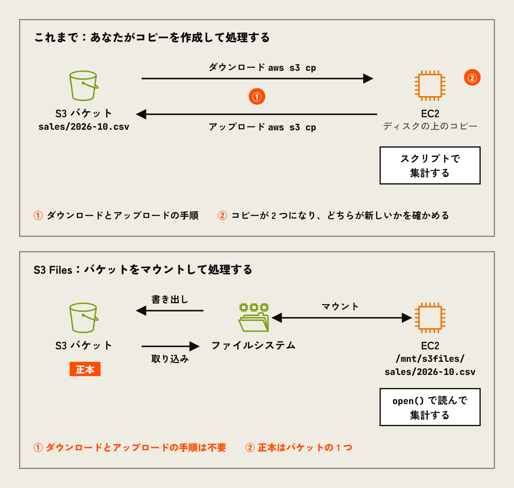
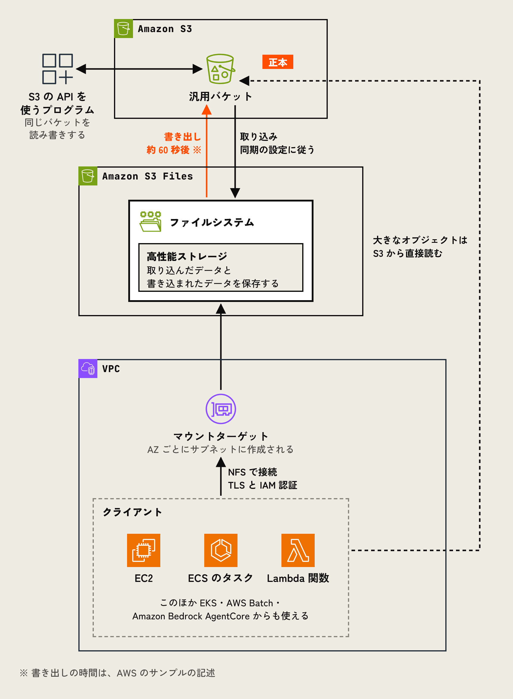
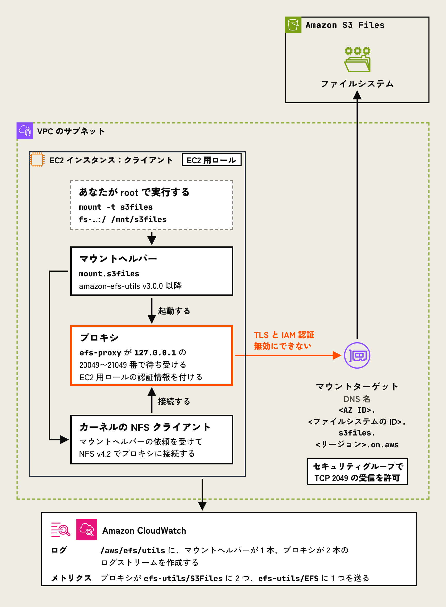
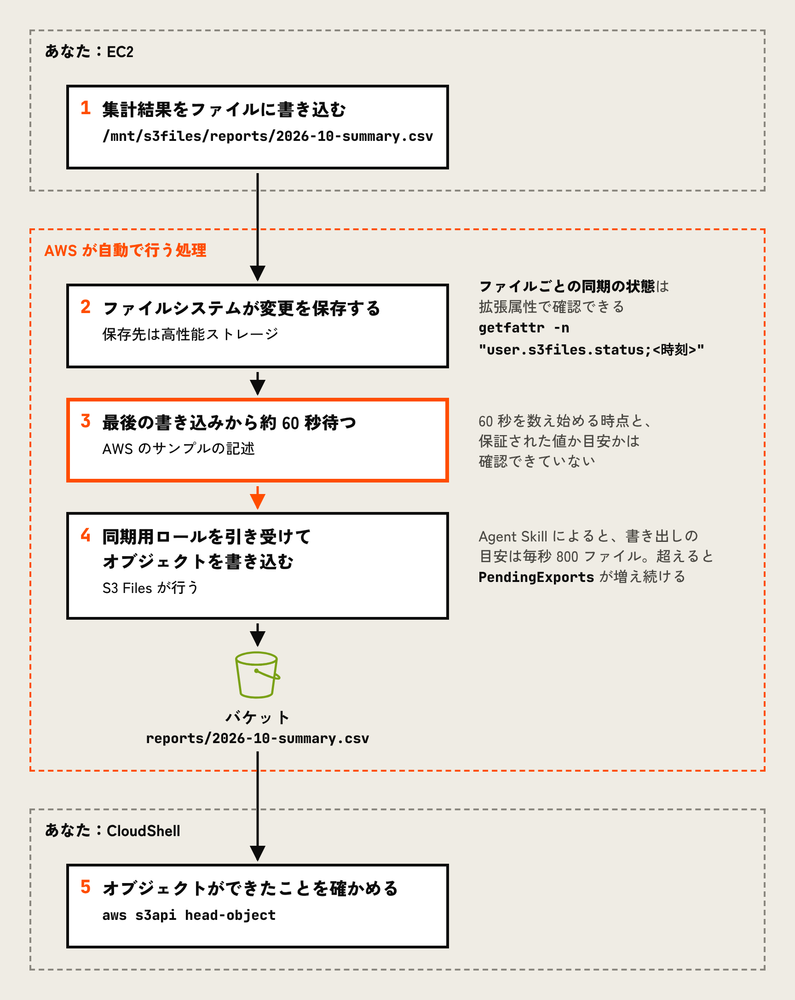
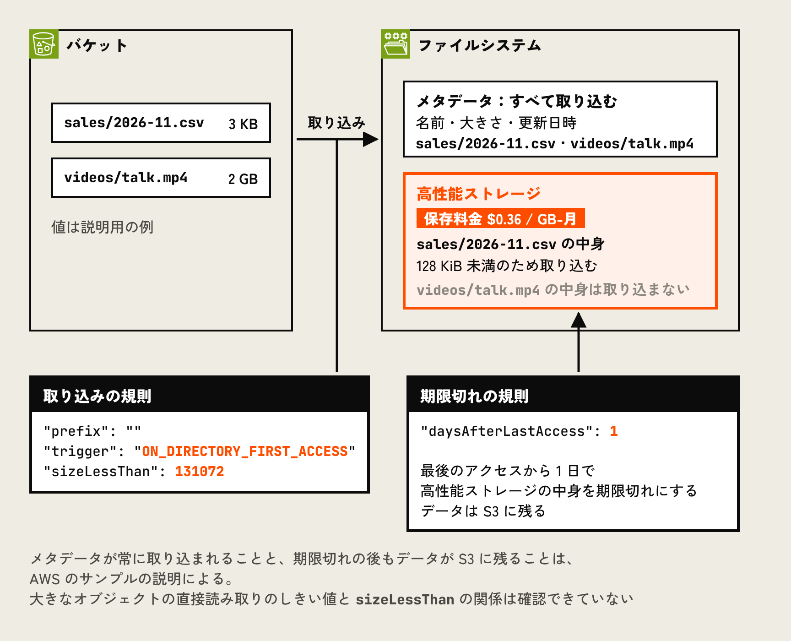
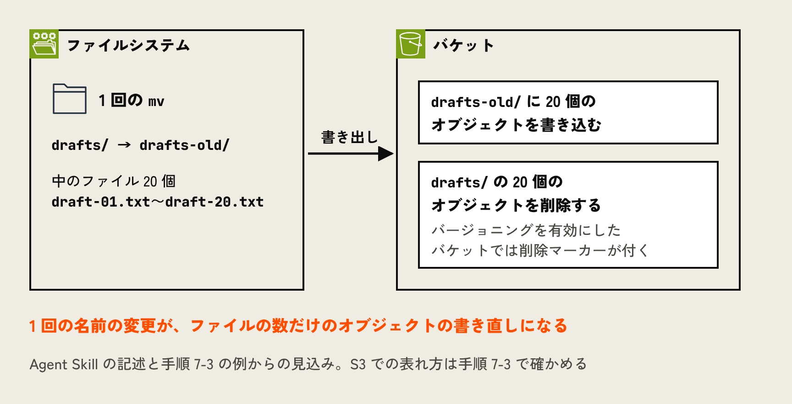
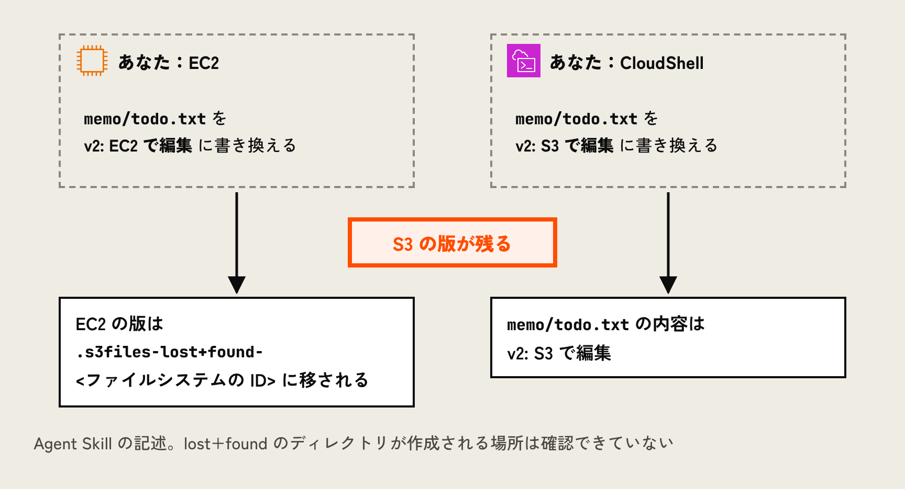
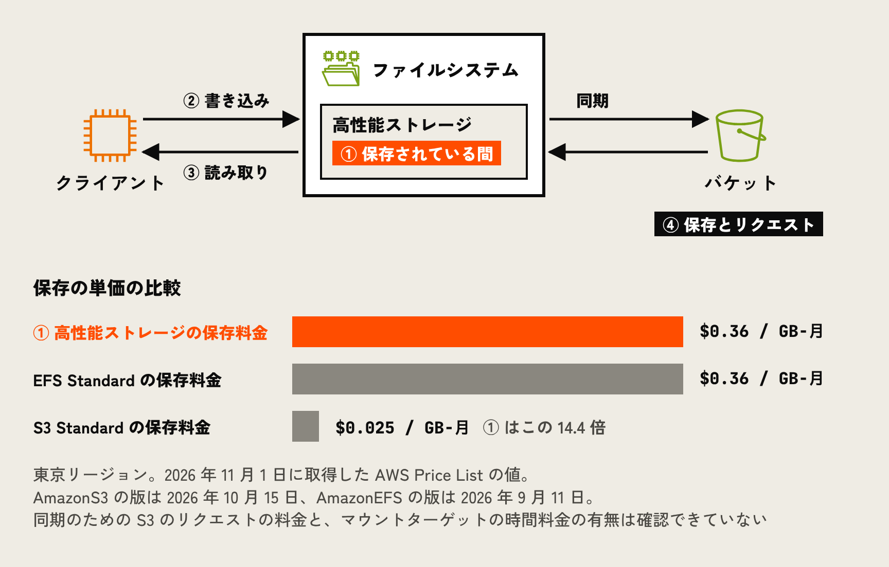
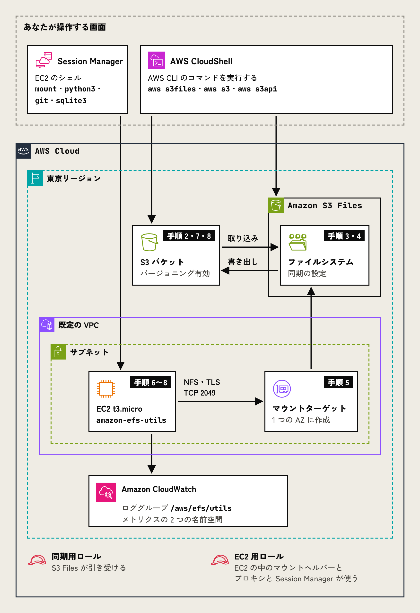

:::note info
AWS Deep Cuts の GitHub はこちらです。
https://github.com/AWS-Deep-Cuts/AWS-Deep-Cuts
:::

# AWS Deep Cutsとは？
AWS Deep Cutsは、AWS の最新のサービスやニッチな機能、または高度にアカデミックな知識を要求するサービスなど、多くの人が知らない 『隠れた名曲 = **Deep Cuts**』 を深くまで掘り下げる技術シリーズです。

このようなサービスはWeb情報も少なく、初学者は気軽にキャッチアップできないのが実情です。

そこで AWS Deep Cuts シリーズでは、**前提知識も含めた分かりやすいサービス解説** と **手順通りに進めれば誰でも再現できるハンズオン** を提供します！

# そもそもオブジェクトストレージとファイルシステムとは？
S3 に保存しているデータを、EC2 で動かすプログラムで処理したいことがあります。たとえば、店舗ごとの売上を毎月 1 つの CSV ファイルにまとめ、`sales/2026-10.csv` という名前で S3 に保存しているとします。この CSV を Python のスクリプトで集計したいとき、まず `aws s3 cp` で CSV を EC2 にダウンロードし、スクリプトで集計してから、結果のファイルを `aws s3 cp` で S3 にアップロードし直す、という手順を踏むことが多いのではないでしょうか。

1 つのファイルを 1 回処理するだけなら、この手順で十分です。しかし、ファイルが数百個に増えると、どのファイルをダウンロード済みでどれを処理して書き戻したのかを、スクリプトかあなた自身が管理しなければなりません。また、別のチームが同じバケットのファイルを更新していると、手元のコピーと S3 のどちらが新しいのかを、処理のたびに確かめる必要があります。確かめずにアップロードすると、別のチームの更新を古い内容で上書きしてしまうおそれもあります。

スクリプトが S3 のデータを、EC2 のディスクにあるファイルと同じように直接開ければ、ダウンロードとアップロードの手順も、コピーの管理も要りません。そうできないのは、S3 と、スクリプトがふだん読み書きしているディスクとで、データの扱い方が違うためです。

S3 は、**オブジェクトストレージ**と呼ばれる種類のストレージです。オブジェクトストレージは、データを**オブジェクト**という単位で保存します。1 つのオブジェクトには、1 つの名前が付きます。この名前を**キー**と呼びます。先ほどの `sales/2026-10.csv` はキーで、途中の `/` もキーの一部です。S3 のコンソールではフォルダのように表示されますが、S3 の中では、`sales/2026-10.csv` という 1 つの名前のオブジェクトとして保存されています。

S3 の API の仕様では、オブジェクトへの書き込みは、オブジェクト全体を新しい内容で上書きする操作です。読み取りでは範囲を指定して一部だけを読めますが、既存のオブジェクトの一部だけを書き換える API はありません。また、オブジェクトの名前を変える API と、オブジェクトの末尾に追記する API は、S3 Express One Zone という特別なストレージクラスを使うバケットだけが対象で、一般的に使われるバケットでは使えません。そのため、一般的なバケットでオブジェクトの名前を変えるには、新しいキーにオブジェクトをコピーしてから、元のオブジェクトを削除します。

一方、Python の `open()` や `grep` コマンドは、OS の**ファイルシステム**を通じてファイルを読み書きします。OS のファイルシステムは、ディレクトリの中にファイルを保存する仕組みで、ファイルの一部だけを書き換える操作や、ファイルの名前を変える操作を提供します。また、他のプログラムが同じファイルに同時に書き込まないように、ファイルを**ロック**する操作も提供します。データベースの SQLite や、バージョン管理の git も、OS のファイルシステムの上で動くことを前提にしています。

ここまでの違いを、操作ごとにまとめると次のようになります。

| 操作 | S3 の API で一般的なバケットを使う場合 | OS のファイルシステム |
| --- | --- | --- |
| 一部だけを読む | できる。範囲を指定して読む | できる |
| 一部だけを書き換える | できない。オブジェクト全体を上書きする | できる |
| 名前を変える | できない。新しいキーにコピーしてから元を削除する | できる |

つまり、S3 のデータを OS のファイルシステムの操作でそのまま読み書きするには、ファイルの操作をオブジェクトの操作に対応させる仕組みが必要です。この仕組みを AWS のサービスとして提供するのが、次の章で紹介する Amazon S3 Files です。

# Amazon S3 Filesとは？
Amazon S3 Files を説明する前に、**マウント**という語を確認します。マウントとは、ネットワークの先にあるストレージを、サーバーの `/mnt/s3files` のようなディレクトリにつないで、そのディレクトリの下でファイルとして読み書きできるようにすることです。マウントしたディレクトリを、**マウント先**と呼びます。

**Amazon S3 Files** は、S3 の**汎用バケット**を、複数のサーバーから同時にマウントできる共有ファイルシステムとして使えるようにするサービスです。汎用バケットは、前の章で「一般的に使われるバケット」と書いた、S3 の標準の種類のバケットです。API の説明によると、S3 Files は、ファイルシステムのサービスである Amazon EFS（Amazon Elastic File System）を基盤にしています。以降、このサービスを単に S3 Files と書きます。

S3 Files では、マウントのための接続先を VPC（Virtual Private Cloud）の中に作成し、サーバーはその接続先を通じてマウントします。VPC は、AWS の中に作成する専用の仮想ネットワークです。そのため、S3 Files をマウントするのは、その VPC の中で動く EC2 インスタンスや Lambda 関数のような AWS の計算資源です。マウントに使うソフトウェアは Linux 向けで、macOS には対応していません。

AWS CLI の変更履歴によると、S3 Files の API は、2026 年 4 月 7 日に公開された AWS CLI 2.34.26 で追加されました。
<!-- 要確認: What's New で発表日と、一般提供かプレビューかを確かめ、書く -->

S3 Files は、バケットを対象にしたファイルシステムを作成します。この記事では、以降、S3 Files が作成するファイルシステムを、単に**ファイルシステム**と呼びます。OS の一般的な仕組みを指すときは、前の章と同じく「OS のファイルシステム」と書きます。

前の章の場面で、S3 Files を使うと何が変わるのかを、次の図で比べます。この記事の図の「あなた」は、S3 Files を使う開発者や運用者を指します。



図の上のこれまでの方法では、あなたが `aws s3 cp` でダウンロードとアップロードの手順を踏み、EC2 のディスクの上のコピーと S3 のオブジェクトの 2 つを管理します。図の下の S3 Files では、EC2 が S3 Files を使ってバケットをマウントし、スクリプトは `/mnt/s3files/sales/2026-10.csv` を `open()` で直接読みます。

データの正しい版として扱う保存場所を、**正本**と呼びます。S3 Files では、バケットが正本です。S3 Files は、ファイルシステムとバケットの間で、変更を互いに自動で反映します。この処理を**同期**と呼びます。同期には 2 つの向きがあります。ファイルシステムでの変更をバケットに反映することを**書き出し**と呼び、図では左向きの矢印で表します。バケットの内容をファイルシステムに反映することを**取り込み**と呼び、図では右向きの矢印で表します。

S3 Files は、ネットワーク越しにファイルシステムを使うための通信の決まりである NFS（Network File System）で、ファイルシステムを提供します。S3 Files が対応する NFS の版は、v4.1 と v4.2 です。

この記事では、API の仕様とあわせて、AWS が公開している次の 2 つの資料を出典として使います。1 つ目は Agent Skill です。AWS は、AWS のサービスの使い方をまとめ、AI エージェントが読み込んで使えるようにした文書を、**Agent Skill** として公開しています。2 つ目は、AWS が aws-samples で公開している、S3 Files を Terraform で作成するサンプルです。以降、このサンプルを **AWS のサンプル**と呼びます。AWS のサンプルは公式ドキュメントではありませんが、AWS が公開しているコードと説明です。

S3 Files には、以下のような特徴があります。

- **S3 のデータをコピーせずにファイルとして読み書きできる**
  S3 Files の Agent Skill は、S3 Files が向いている場面として、データがすでに S3 の汎用バケットにあり、ファイルとして読み書きしたい場合を挙げています。同じデータに API とファイルの両方でアクセスしたいが、コピーはしたくない場合も挙げています。
- **OS のファイルシステムの操作が使える**
  Agent Skill によると、アプリケーションは、NFS でファイルの読み書き・ロック・削除ができます。ただし、名前の変更には注意が必要です。理由は、仕組みの章で説明します。
- **同期は自動で双方向に行われる**
  AWS のサンプルによると、マウントしたディレクトリに書いたファイルは、最後の書き込みから約 60 秒後にバケットへ書き出されます。取り込みがいつ行われるかは、仕組みの章で説明する同期の設定で決まります。
- **よく使う小さなファイルは高性能ストレージから返す**
  ファイルシステムは、取り込んだデータと書き込まれたデータを、バケットとは別のストレージに保存します。このストレージを、**高性能ストレージ**と呼びます。Agent Skill によると、S3 Files は、小さくよく使われるファイルを高性能ストレージから返し、大きな読み取りではデータを S3 から直接読みます。API の説明には、仕組みの章で説明するマウントターゲットを通じて、1 ms 未満のレイテンシでアクセスできると書かれています。ただし、どのデータのどの操作の値かは、確認できていません。
- **さまざまな計算資源からマウントできる**
  EC2 の他に、Amazon ECS（Amazon Elastic Container Service）のタスク、Amazon EKS（Amazon Elastic Kubernetes Service）、AWS Lambda、AWS Batch、Amazon Bedrock AgentCore から使えます。EKS では、EFS CSI（Container Storage Interface）ドライバーの v3.0.0 以降が S3 Files に対応しています。Lambda から使うときの条件は、活用事例の章で説明します。
- **通信は常に暗号化され IAM で認証される**
  **TLS**（Transport Layer Security）は、通信を暗号化する仕組みです。**IAM 認証**は、マウントするクライアントの IAM（AWS Identity and Access Management）の認証情報を S3 Files が確かめ、IAM のポリシーでマウントや書き込みが許可されているかを判定することです。マウントに使うソフトウェアである amazon-efs-utils の説明書によると、S3 Files のマウントでは、TLS と IAM 認証は常に有効で、無効にできません。
- **料金は S3 の価格表に載っている**
  高性能ストレージの保存・書き込み・読み取りの単価は、AWS の価格表である AWS Price List の、Amazon S3 の価格表に載っています。バケットには、これとは別に通常の S3 の料金がかかります。詳しくは、仕組みの章の料金の節で説明します。
- **東京リージョンで使える見込み**
  AWS Price List には東京リージョンの単価が載っています。また、2026 年 11 月 1 日に筆者が認証情報を付けずに東京リージョンの API のエンドポイントに接続したところ、HTTP 403 の応答が返りました。これはエンドポイントがあることを示しますが、アカウントでファイルシステムを作成できることの証明ではありません。その後、2026 年 11 月 7 日のハンズオンの検証では、東京リージョンでファイルシステムとマウントターゲットを作成し、EC2 からマウントできました。ただし、筆者は、公式の提供リージョンの一覧を確認できていません。
  <!-- 要確認: 公式の提供リージョンの一覧で東京を確かめ、「東京リージョンで使えます」と言い切れるなら直す。実機では 2026-11-07 に東京で作成とマウントができた -->

S3 のデータをファイルとして扱う方法は、S3 Files の他にもあります。主な方法を、ファイルとして読み書きできるかと、データを S3 に保存したまま使えるかで比べると、次のようになります。○ は満たす、△ は条件付きで満たす、× は満たさないことを表します。評価は筆者によるものです。

| 方法 | ファイルとして読み書きできる | データを S3 に保存したまま使える |
| --- | :---: | :---: |
| ダウンロードして処理し、アップロードし直す | ○ 手元のコピーに対して | × |
| Mountpoint for Amazon S3 でバケットをマウントする | △ | ○ |
| データを Amazon EFS にコピーして、EFS をマウントする | ○ | × |
| **Amazon S3 Files** | ○ | ○ |

- **ダウンロードして処理する方法**では、読み書きするのは EC2 のディスクの上のコピーです。S3 のデータそのものではないため、前の章で説明したコピーの管理が必要です。
- **Mountpoint for Amazon S3** は、S3 のバケットを Linux のディレクトリにマウントするクライアントのソフトウェアです。Agent Skill によると、Mountpoint for Amazon S3 は読み取りが中心のクライアントで、できる操作は読み取りだけか追記だけに限られます。
- **Amazon EFS** は、AWS のファイルストレージのサービスです。S3 のデータを EFS で扱うには、データを EFS にコピーする必要があります。Agent Skill は、データがすでに S3 にある場合は、EFS ではなく S3 Files を選ぶよう案内しています。

表の方法のうち、両方の列が ○ になるのは S3 Files だけです。S3 Files では、データを S3 に保存したまま、コピーせずにファイルとして読み書きできます。

:::note info
**名前が似た別の機能**
Agent Skill によると、S3 Files は、Mountpoint for Amazon S3・S3 File Gateway・File Cache のいずれとも別のものです。S3 Files では、AWS CLI のコマンドは `aws s3files`、IAM のアクションは `s3files:` で始まり、マウントには `mount -t s3files` を使います。資料を調べるときは、これらの名前で区別できます。
:::

ここまでで、S3 Files がバケットを正本としたまま、ファイルシステムとしてマウントできるようにするサービスであることを説明しました。ただし、バケットが正本であることには、知っておくべき帰結があります。次の章で、仕組みとあわせて説明します。

# 仕組み
バケットが正本であることの帰結を説明する前に、まず S3 Files を構成する部品の全体像を確認します。



図の上から順に説明します。一番上の汎用バケットが正本です。左上のプログラムのように、S3 の API を使うプログラムは、これまでどおり同じバケットを読み書きできます。

その下の Amazon S3 Files の枠の中が、ファイルシステムです。ファイルシステムの中の高性能ストレージには、取り込んだデータと書き込まれたデータが保存されます。バケットとファイルシステムの間の 2 本の矢印が、前の章で説明した書き出しと取り込みです。

図の下の VPC の枠の中にある**マウントターゲット**は、VPC の中の計算資源がファイルシステムをマウントするための接続先です。マウントターゲットは、AZ（Availability Zone）ごとに、サブネットに作成します。ファイルシステムをマウントして使う計算資源を、**クライアント**と呼びます。図では、EC2、ECS のタスク、Lambda 関数がクライアントです。クライアントは、NFS でマウントターゲットに接続します。図の右側の点線は、大きなオブジェクトの読み取りで、クライアントが S3 から直接データを読む経路です。この経路は、後の「S3 の変更がファイルシステムに届くまで」の節で説明します。

この章の各節で説明することと、主な API とコマンドは、次のとおりです。

| 節 | 主な API とコマンド | 説明すること |
| --- | --- | --- |
| ファイルシステムとマウントターゲットの作成 | `CreateFileSystem`・`CreateMountTarget` | 作成に必要な 3 つのもの |
| マウントで起きること | `mount -t s3files` | プロキシ、TLS と IAM 認証、ログとメトリクス |
| 書き込みが S3 に届くまで | なし | 書き出しの時間と、同期の状態の確かめ方 |
| S3 の変更がファイルシステムに届くまで | `PutSynchronizationConfiguration` | 取り込みの規則、期限切れの規則、直接読み取り |
| 名前の変更と競合 | なし | オブジェクトの書き直しと、S3 の版が残ること |
| 料金 | なし | 料金の要素と、どの操作でどの料金がかかるか |

## ファイルシステムとマウントターゲットの作成
S3 Files を使い始めるには、ファイルシステム・同期用ロール・マウントターゲットの 3 つを用意します。

まず、あなたは `CreateFileSystem` API を呼び出して、ファイルシステムを作成します。API の仕様では、主に次のものを指定します。表の ARN（Amazon Resource Name）は、AWS のリソースを一意に識別するための名前です。

| 指定するもの | 必須か | 内容 |
| --- | --- | --- |
| バケットの ARN | 必須 | 存在していて、ファイルシステムと同じリージョンにあるバケット |
| 同期用ロール | 必須 | この後で説明する IAM ロールの ARN |
| プレフィックス | 任意 | ファイルシステムで扱う範囲。省くとバケット全体になる |
| KMS キー | 任意 | 保存するデータの暗号化に使う AWS KMS（AWS Key Management Service）のキー。指定しなくても、既定で暗号化される |
| タグ | 任意 | `Name` タグの値が、ファイルシステムの名前になる |

**プレフィックス**は、キーの先頭の共通部分です。たとえば `sales/` をプレフィックスに指定すると、`sales/` で始まるキーのオブジェクトだけがファイルシステムの範囲になります。プレフィックスには、空の文字列か、`/` で終わる文字列を指定します。

**同期用ロール**は、S3 Files が、ファイルシステムとバケットの間でデータを読み書きするときに引き受ける IAM ロールです。IAM ロールを引き受けるとは、S3 Files のような AWS のサービスが、IAM ロールに付与された権限を一時的に使って AWS のリソースを操作することです。

同期用ロールには、注意が必要な点があります。IAM ロールには、そのロールを誰が引き受けられるかを定める信頼ポリシーを設定します。AWS のサンプルでは、同期用ロールの信頼ポリシーで引き受けを許可するプリンシパルが、名前から想像しやすい `s3files.amazonaws.com` ではなく、EFS のサービスの `elasticfilesystem.amazonaws.com` になっています。AWS のサンプルの信頼ポリシーを JSON で表すと、次のとおりです。アカウント ID は、説明用の値 111122223333 にしています。

```json
{
  "Version": "2012-10-17",
  "Statement": [
    {
      "Effect": "Allow",
      "Principal": { "Service": "elasticfilesystem.amazonaws.com" },
      "Action": "sts:AssumeRole",
      "Condition": {
        "StringEquals": { "aws:SourceAccount": "111122223333" },
        "ArnLike": { "aws:SourceArn": "arn:aws:s3files:ap-northeast-1:111122223333:file-system/*" }
      }
    }
  ]
}
```

この点を見落として信頼ポリシーを誤ると、誤りに気付くのが遅れます。ロールの設定を誤っても、ファイルシステムを作成するコマンドはエラーにならないためです。Agent Skill によると、S3 Files は、作成の時点では同期用ロールの権限を検証しません。信頼ポリシーや権限が誤っていると、ファイルシステムの状態は `creating` のまま変わらず、状態の詳細を表す `statusMessage` に、アクセスが拒否されたことが表示されます。この場合は、ロールを修正してから、ファイルシステムを削除して作成し直します。

AWS のサンプルは、同期用ロールに、バケットとオブジェクトを読み書きする権限と、名前が `DO-NOT-DELETE-S3-Files` で始まる EventBridge のルールを管理する権限を付与しています。**EventBridge** は、AWS のサービスで起きた変更などのイベントを、規則に従って他のサービスに届けるサービスです。この権限から、S3 Files が S3 側の変更を検知するために EventBridge のルールを使っていると読み取れます。ただし、筆者はこの点を説明した公式の文書を確認できていません。筆者の検証（2026 年 11 月）では、ファイルシステムの作成で、名前が `DO-NOT-DELETE-S3-Files` で始まるルールが 1 つ作成され、ファイルシステムの削除とともに無くなりました。

次に、あなたは `CreateMountTarget` API を呼び出して、マウントターゲットを作成します。マウントターゲットは、特定の AZ と VPC のクライアントがファイルシステムをマウントするための接続先です。作成するときにサブネットを指定し、そのサブネットでマウントターゲットの AZ が決まります。

API の仕様によると、マウントターゲットを作成すると、S3 Files が管理するネットワークインターフェイスがサブネットに作成されます。このようなネットワークインターフェイスを、ENI（elastic network interface）と呼びます。ENI は、VPC のサブネットに作成され、IP アドレスを持つネットワークインターフェイスです。マウントターゲットには、セキュリティグループを指定します。NFS は TCP の 2049 番ポートを使うため、マウントターゲットのセキュリティグループで、クライアントからの TCP 2049 の受信を許可します。セキュリティグループを指定しないと、VPC の既定のセキュリティグループが使われます。

クライアントは、`<AZ ID>.<ファイルシステムの ID>.s3files.<リージョン>.on.aws` という形の DNS 名で、マウントターゲットに接続します。**AZ ID** は、`apne1-az4` のように、アカウントによらず同じ AZ を指す識別子です。`ap-northeast-1a` のような AZ の名前と実際の AZ との対応は、アカウントによって異なることがあります。Agent Skill によると、クライアントは別の AZ のマウントターゲットにもマウントできますが、レイテンシが増えます。AWS のサンプルでは、マウントターゲットの作成に約 5 分かかると書かれています。

:::note info
**大量のオブジェクトを含むプレフィックスの場合**
API の仕様では、バケットの構成に警告がある場合、ファイルシステムの作成が失敗することがあります。`CreateFileSystem` の `acceptBucketWarning` を `true` にすると、警告を受け入れて作成できます。Terraform の AWS プロバイダーの文書は、警告が出る例として、約 1,200 万個のオブジェクトを含むプレフィックスを挙げています。
:::

## マウントで起きること
ファイルシステムとマウントターゲットを用意したら、クライアントからマウントします。マウントのコマンドを 1 つ実行するだけですが、裏側では、EC2 の中で 2 つのプログラムが動き、OS の NFS の機能と連携します。その流れを示したのが、次の図です。



図の一番上の箱のとおり、あなたは EC2 の中で、root の権限で次のコマンドを実行します。ファイルシステムの ID は、説明用の値です。

```bash
sudo mount -t s3files fs-0123456789abcdef0:/ /mnt/s3files
```

このコマンドで動くプログラムを、**マウントヘルパー**と呼びます。S3 Files のマウントヘルパー `mount.s3files` は、amazon-efs-utils というパッケージの v3.0.0 以降に含まれています。v3.0.0 は、2026 年 4 月 7 日に公開されました。

マウントヘルパーは、まず NFS の通信を中継するプロセスである**プロキシ**を起動します。プロキシのプロセスの名前は `efs-proxy` で、EC2 の中の `127.0.0.1` の 20049〜21049 番のいずれかのポートで接続を待ち受けます。

次に、マウントヘルパーは、OS の**カーネル**の NFS クライアントに、マウントを依頼します。カーネルは、OS の中心部分のプログラムで、NFS のクライアントもカーネルの中で動きます。マウントヘルパーのソースコードによると、マウントヘルパーは、接続先としてマウントターゲットではなく `127.0.0.1` とプロキシのポートを渡します。そのため、カーネルの NFS クライアントは、NFS v4.2 でプロキシに接続します。

プロキシは、受け取った NFS の通信を TLS で暗号化し、IAM の認証情報を付けて、マウントターゲットの TCP 2049 番ポートに送ります。EC2 では、プロキシは、EC2 インスタンスに関連付けた IAM ロールの認証情報を使います。このシリーズでは、このロールを **EC2 用ロール**と呼びます。

EC2 用ロールには、クライアントのための次の IAM のアクションを許可します。

| アクション | 許可する操作 |
| --- | --- |
| `s3files:ClientMount` | ファイルシステムをマウントする |
| `s3files:ClientWrite` | ファイルシステムに書き込む |
| `s3files:ClientRootAccess` | root としてアクセスする |

AWS のサンプルによると、EC2 からファイルシステムのルートディレクトリに書き込むには、`s3files:ClientRootAccess` が必要です。

前の章で説明したとおり、TLS と IAM 認証は常に有効で、無効にできません。マウントヘルパーのソースコードによると、NFS の版に v4.0 を指定すると、マウントヘルパーはエラーで止まります。

マウントが終わらないときや、マウントした後に読み書きできなくなったときは、クライアント側の記録で原因を調べます。この記録として、マウントヘルパーとプロキシは、マウントの記録と通信の状態を CloudWatch に送ります。CloudWatch Logs で、ログをまとめる単位を**ロググループ**、その中の 1 本の記録の列を**ログストリーム**と呼びます。amazon-efs-utils のソースコードによると、2 つのプログラムは、同じロググループ `/aws/efs/utils` に、別々のログストリームを作成します。

| 送るプログラム | ログストリームの名前 | 記録する内容 |
| --- | --- | --- |
| マウントヘルパー | `<ファイルシステムの ID> - <インスタンス ID> - mount.log` | マウントの処理 |
| プロキシ | `<ファイルシステムの ID>-<インスタンス ID>-efs-utils` | NFS の接続の状態 |
| プロキシ | `<バケット名>-<インスタンス ID>-efs-utils` | バケットへの接続の状態 |

また、プロキシは、通信の状態を表す 3 つのメトリクスを、CloudWatch に送ります。CloudWatch でメトリクスをまとめる単位を、**名前空間**と呼びます。ソースコードによると、3 つのメトリクスは、次の 2 つの名前空間に分かれます。値は、状態が正常なら 1、そうでなければ 0 です。

| メトリクス | 名前空間 | 表す状態 | 次元 |
| --- | --- | --- | --- |
| `S3BucketReachable` | `efs-utils/S3Files` | バケットに接続できるか | Bucket・InstanceId |
| `S3BucketAccessible` | `efs-utils/S3Files` | バケットを読む権限があるか | Bucket・InstanceId |
| `NFSConnectionAccessible` | `efs-utils/EFS` | マウントターゲットへの NFS の接続が確立しているか | FileSystemId・InstanceId |

ソースコードによると、プロキシは、既定の設定では `NFSConnectionAccessible` を 60 秒ごとに送り、S3 の 2 つのメトリクスを、バケットへの接続と権限を確かめるたびに送ります。S3 の 2 つのメトリクスは、後の節で説明する直接読み取りが有効な場合に送られます。筆者がハンズオンで確かめたところ、3 つのメトリクスはどれも 1 分に 1 件ずつ記録されていました。一方、表の 1 行目のマウントヘルパーのログストリームは CloudWatch Logs に現れず、マウントの記録は EC2 インスタンスの中のファイル `/var/log/amazon/efs/mount.log` にだけありました。プロキシがログとメトリクスを送るには、EC2 用ロールに、`cloudwatch:PutMetricData` と CloudWatch Logs への書き込みの権限が必要です。

プロキシは、S3 Files 専用のプログラムではなく、EFS のマウントにも使われるプログラムです。そのため、NFS の接続の記録には `NFS connection to EFS is established` と書かれ、メトリクスの名前空間にも `EFS` が付きます。筆者は、この点が、S3 Files が EFS を基盤にしていることと整合すると考えています。ただし、これはプロキシのコードが EFS と共通であることを示すもので、S3 Files の内部の構成を証明するものではありません。

ログとメトリクスの送信に失敗したときの扱いは、出典によって書き方が異なります。マウントヘルパーのソースコードでは、ロググループの作成に失敗しても、マウントの処理は続きます。プロキシも、メトリクスの送信に失敗すると、警告をログに残すだけです。一方、Agent Skill によると、インターネットに接続できない VPC では、CloudWatch Logs の VPC エンドポイントが無いと、マウントが完了しません。プライベートサブネットで使うときの対策は、ベストプラクティスの章で説明します。

## 書き込みが S3 に届くまで
マウントできたら、クライアントはファイルを読み書きできます。この節では、クライアントで書いたファイルが、いつバケットのオブジェクトになるのかを確認します。ハンズオンで作成する集計結果のファイル `reports/2026-10-summary.csv` を例に、1 回の書き込みで起きることを順に示したのが、次の図です。



1. あなたが EC2 で、`/mnt/s3files/reports/2026-10-summary.csv` に集計結果を書き込みます。書き込みは、カーネルの NFS クライアントからプロキシとマウントターゲットを通って、ファイルシステムに届きます。
2. ファイルシステムが、変更を高性能ストレージに保存します。
3. ファイルシステムは、すぐにはバケットへ書き出しません。AWS のサンプルによると、書き出しは、最後の書き込みから約 60 秒後に行われます。Agent Skill は、書き込みは約 60 秒以内に同期すると書いています。ただし、60 秒を数え始める時点が最後の書き込みなのかファイルを閉じた時点なのかと、この値が保証された値なのか目安なのかは、確認できていません。
4. 書き出しでは、S3 Files が同期用ロールを引き受けて、バケットにオブジェクト `reports/2026-10-summary.csv` を書き込みます。API の仕様では、同期用ロールは、ファイルシステムとバケットの間でデータを読み書きする権限を S3 Files に与えるロールです。
5. あなたが CloudShell で、オブジェクトができたことを確かめます。

ファイルごとの同期の状態は、**拡張属性**で確認できます。拡張属性とは、ファイルの中身とは別に、ファイルに付けられる名前と値の組です。Agent Skill は、同期の状態を、次のように拡張属性 `user.s3files.status` から読む方法を案内しています。

```bash
getfattr -n "user.s3files.status;$(date -u +%s)" /mnt/s3files/reports/2026-10-summary.csv --only-values
```

筆者の検証（2026 年 11 月）では、書き出しの前の値は `S3Key:` の後ろが空で、書き出しの後は `S3Key:` の後ろにオブジェクトのキー `reports/2026-10-summary.csv` が表示されました。出力の例は、ハンズオンの手順 7-1 に載せています。

大量のファイルを書く場合の目安も、Agent Skill に書かれています。Agent Skill によると、書き出しの処理量の目安は毎秒 800 ファイルで、これを超えると、CloudWatch のメトリクス `PendingExports` が増え続けます。対策は、データを複数のファイルシステムに分けることです。

書き出しに失敗したときは、Agent Skill によると、次のような種類のエラーになります。

| エラーの種類 | 原因 |
| --- | --- |
| `S3AccessDenied` | バケットへのアクセスが拒否された |
| `S3BucketNotFound` | バケットが見つからない |
| `RoleAssumptionFailed` | 同期用ロールを引き受けられない |
| `EncryptionKeyInaccessible` | 暗号化のキーを使えない |
| `PathTooLong` | ファイルのパスが、S3 のキーの上限である 1,024 バイトを超えた |

この書き出しの仕組みから、筆者は、次の 2 点に注意が必要だと考えます。1 つ目に、S3 の API でバケットを読むプログラムからは、ファイルシステムでの変更は、書き出しが終わるまで読めません。2 つ目に、複数のファイルを続けて書いた場合は、ファイルごとに書き出されるため、S3 の API で読むプログラムが、一部のファイルだけが更新された途中の状態を読むことがあります。

まだバケットに書き出していない変更は、ファイルシステムの削除にも関係します。API の仕様では、書き出していないデータがあると、ファイルシステムの削除は既定で失敗します。`DeleteFileSystem` の `forceDelete` を `true` にすると削除できますが、データを失うことがあります。

## S3 の変更がファイルシステムに届くまで
次は反対の向きで、S3 の API でバケットに書き込んだオブジェクトが、ファイルとして読めるようになるまでを確認します。ここでは、オブジェクトの**メタデータ**と**中身**を分けて考えます。メタデータは、オブジェクトの名前・大きさ・更新日時のような、中身以外の情報です。中身は、オブジェクトのデータそのものです。取り込みにかかる時間は、この記事の調査で使った資料には書かれていないため、ハンズオンの手順 7-2 で計測します。

AWS のサンプルの説明によると、メタデータは常に取り込まれます。Agent Skill によると、ディレクトリに初めてアクセスしたときは、メタデータを取り込むために時間がかかりますが、これは正常な動作です。

一方、中身をどこまで高性能ストレージに取り込むかは、**同期の設定**で決まります。同期の設定は、**取り込みの規則**と**期限切れの規則**の組です。API の仕様では、取り込みの規則は 1〜10 個、期限切れの規則はちょうど 1 個で、どちらも必須です。あなたは、`PutSynchronizationConfiguration` API で同期の設定を変更します。同期の設定が高性能ストレージに何を保存し、いつ期限切れにするかを示したのが、次の図です。図の値は、説明用の例です。



次の JSON は、ハンズオンの手順 4 で設定する同期の設定の抜粋です。

```json
{
  "importDataRules": [
    { "prefix": "", "trigger": "ON_DIRECTORY_FIRST_ACCESS", "sizeLessThan": 131072 }
  ],
  "expirationDataRules": [
    { "daysAfterLastAccess": 1 }
  ]
}
```

それぞれのキーの意味は、次のとおりです。

| 規則 | キー | 意味 | この例の値 |
| --- | --- | --- | --- |
| 取り込みの規則 | `prefix` | 規則を適用するキーのプレフィックス。空の文字列はファイルシステムの範囲全体 | `""` |
| 取り込みの規則 | `trigger` | 取り込みを始めるきっかけ。`ON_DIRECTORY_FIRST_ACCESS` はディレクトリに初めてアクセスしたとき、`ON_FILE_ACCESS` はファイルにアクセスしたとき | `ON_DIRECTORY_FIRST_ACCESS` |
| 取り込みの規則 | `sizeLessThan` | この値より小さいオブジェクトだけ、中身を取り込む。単位はバイト | `131072`。つまり 128 KiB |
| 期限切れの規則 | `daysAfterLastAccess` | 最後のアクセスから、この日数が過ぎた中身を、高性能ストレージで期限切れにする。1〜365 日 | `1` |

AWS のサンプルの説明によると、期限切れになった後も、データは S3 に残ります。AWS のサンプルは、128 KiB 未満のオブジェクトの中身を `ON_DIRECTORY_FIRST_ACCESS` で取り込み、30 日で期限切れにする値を使っています。筆者の検証（2026 年 11 月）では、ファイルシステムを作成した直後から同期の設定があり、値はこのサンプルと同じ、128 KiB 未満・`ON_DIRECTORY_FIRST_ACCESS`・30 日でした。ファイルシステムを作成した直後の同期の設定は、ハンズオンの手順 4 で `GetSynchronizationConfiguration` API を呼び出して確かめます。

同期の設定を 2 回目以降に変更するときは、API の仕様では、現在の設定のバージョンの番号を `latestVersionNumber` で渡します。番号が現在の設定と食い違うと、変更は `ConflictException` で失敗します。また、同期の設定を削除する API はありません。

取り込まない大きなオブジェクトの読み取りには、別の経路があります。amazon-efs-utils の説明書によると、S3 Files は読み取りの経路を自動で選び、大きなオブジェクトは、クライアントがバケットから直接読みます。これを、**直接読み取り**と呼びます。全体像の図の右側の点線が、この経路です。直接読み取りのために、クライアントのロールには `s3:GetObject` と `s3:GetObjectVersion` の権限が必要です。マウントのオプションに `nodirects3read` を付けると、すべての読み取りがファイルシステムを経由します。Lambda では `DirectS3Read` という設定で選び、API の仕様では、既定の `AUTO` の場合、メモリが 512 MB 以上の関数で直接読み取りが働きます。

ただし、どのくらいの大きさから「大きい」とみなされるのかと、取り込みの規則の `sizeLessThan` との関係は、確認できていません。

なお、S3 Glacier のストレージクラスなどに移したアーカイブ済みのオブジェクトは、Agent Skill によると、先に復元しないと、読み取りが I/O エラーになります。

## 名前の変更と競合
ここまでで、書き出しと取り込みの 2 つの向きを確認しました。この 2 つが組み合わさると、OS のファイルシステムでは起きないことが起きます。

1 つ目は、名前の変更です。OS のファイルシステムではすぐに終わる名前の変更が、S3 Files では時間と費用のかかる操作になります。Agent Skill によると、ファイルやディレクトリの名前の変更と移動は、オブジェクトの書き直しになり、遅く、費用もかかります。理由は、「そもそもオブジェクトストレージとファイルシステムとは？」の章で説明したとおり、汎用バケットにはオブジェクトの名前を変える API が無いためです。



図のように、20 個のファイルを含むディレクトリの名前を 1 回変えると、新しい名前のキーに 20 個のオブジェクトが書き込まれ、元の名前の 20 個のオブジェクトが削除されます。筆者は、ハンズオンの手順 7-3 で、この動作を実機で確かめました（2026 年 11 月）。

2 つ目は、**競合**です。競合とは、同じファイルが、ファイルシステムと S3 の両方で同時に変更されることです。ただし、Agent Skill は、どのくらいの時間の差までを「同時」とみなすのかを書いていません。Agent Skill によると、競合が起きると、S3 の版が残り、ファイルシステム側の版は `.s3files-lost+found-<ファイルシステムの ID>` という名前のディレクトリに移されます。このディレクトリを、**lost+found のディレクトリ**と呼びます。筆者の検証（2026 年 11 月）では、lost+found のディレクトリは、マウントした直後から、ファイルシステムの最上位のディレクトリにありました。
<!-- 要確認: 「同時」の条件。手順 7-4 の実機（2026-11）では、EC2 と S3 で約 1 秒の差で書き換えると競合になった。書き出しが終わる前の S3 の変更が競合になるという一般の条件は、公式の文書で確かめていない -->



この動作が、「Amazon S3 Filesとは？」の章の最後で触れた、バケットが正本であることの帰結です。ファイルシステムでの変更が S3 での変更と食い違うと、S3 の版が優先されます。ファイルシステムで書いた内容も、書き出しが終わってバケットに反映されるまでは、正本になっていません。

## 料金
最後に、ここまでに出てきた操作に、どのような料金がかかるのかを説明します。S3 Files には専用の価格表がなく、単価は AWS Price List の Amazon S3 の価格表に、ストレージクラス `Files` として載っています。S3 Files の料金は、次の 4 つの要素で決まります。単価は、2026 年 11 月 1 日に取得した AWS Price List の東京リージョンの値です。Amazon S3 の価格表の版は、2026 年 10 月 15 日に公開されたものです。

| 料金の要素 | かかるとき | 東京リージョンの単価 |
| --- | --- | --- |
| ① 高性能ストレージの保存料金 | 高性能ストレージにデータが保存されている間 | GB-月あたり $0.36 |
| ② 書き込みの料金 | ファイルシステムにデータを書き込むとき | GB あたり $0.07 |
| ③ 読み取りの料金 | ファイルシステムからデータを読み取るとき | GB あたり $0.04 |
| ④ 通常の S3 の料金 | バケットにデータを保存している間と、リクエストのとき | S3 Standard の保存は最初の 50 TB まで GB-月あたり $0.025。PUT・COPY・POST・LIST は 1,000 件あたり $0.0047。GET などは 10,000 件あたり $0.0037 |

米国東部のバージニア北部リージョンでは、①〜③ の単価は、それぞれ $0.30、$0.06、$0.03 です。次の図は、どの操作でどの料金がかかるかと、保存の単価の比較を示しています。



図の下の棒のとおり、① の高性能ストレージの保存料金は、S3 Standard の保存料金の 14.4 倍です。そのため、筆者は、同期の設定で、高性能ストレージに保存するデータの大きさと期間を決めることが、S3 Files の費用の設計になると考えています。取り込みの規則の `sizeLessThan` で取り込むオブジェクトの大きさを、期限切れの規則の `daysAfterLastAccess` で保存する期間を決められます。

また、図の 2 本目の棒のとおり、東京リージョンでは、① の単価は EFS Standard の保存料金の単価と同じです。さらに、② と ③ の単価も、EFS の Elastic スループットの書き込みと読み取りの単価と同じです。Elastic スループットは、EFS で、読み書きしたデータの量に応じて料金がかかる方式です。2026 年 11 月 1 日に取得した AWS Price List では、バージニア北部リージョンでも、S3 Files と EFS の 3 つの単価は同じでした。筆者は、この一致も、S3 Files が EFS を基盤にしていることと整合すると考えています。ただし、S3 Files の単価は Amazon S3 の価格表に載っており、EFS の価格表には載っていません。

計算の例を示します。説明用の例として、1 か月に、高性能ストレージに平均 10 GB のデータを保存し、20 GB を書き込み、50 GB を読み取ったとします。読み取りは、すべてファイルシステムを経由したものとします。この場合、東京リージョンでの ①〜③ の料金は、次のとおりです。

| 料金の要素 | 計算 | 金額 |
| --- | --- | --- |
| ① 高性能ストレージの保存料金 | 10 GB × $0.36 | $3.60 |
| ② 書き込みの料金 | 20 GB × $0.07 | $1.40 |
| ③ 読み取りの料金 | 50 GB × $0.04 | $2.00 |
| 合計 | | $7.00 |

これに、④ の通常の S3 の料金が加わります。

:::note warn
**確認できていない料金の細則**
2026 年 11 月 1 日時点で、筆者は次の点を、AWS Price List と、この記事の調査で使った資料からは確認できていません。

- マウントターゲットとアクセスポイントに、時間あたりの料金がかかるか
- 書き込みと読み取りに、最小の課金単位があるか
- 書き出しと取り込みのための S3 のリクエストの料金が、誰の請求に、どの要素としてかかるか
- 直接読み取りで S3 から読んだ分が、③ の読み取りの料金に含まれるか
- 請求の画面で、S3 Files の料金がどの名前で表示されるか

正確な料金は、Amazon S3 の料金のページで確認してください。
:::
<!-- 要確認: 料金のページと計量のページ（s3-files-metering.html）で、上の 5 点を確かめる -->

# Amazon S3 Filesの主な活用事例
ここまでで、S3 Files が、バケットを正本としたまま、ファイルシステムとしてマウントできるようにし、変更を自動で同期することを説明しました。この特徴を生かせる場面を紹介します。いずれも、Agent Skill・API の説明・AWS が公開しているサンプルをもとに、筆者が整理したものです。

- **S3 にあるデータをファイルを扱うツールで処理する**
  冒頭の場面のように、S3 に保存したデータを、Python のスクリプトや `grep` のような、ファイルを読み書きするツールで処理できます。API の説明は、S3 Files の用途として、AI と機械学習、メディアの処理、同じデータにファイルとオブジェクトの両方でアクセスするストレージのワークフローを挙げています。
- **Lambda 関数からファイルとして読み書きする**
  Lambda 関数は、`/mnt/` で始まるマウント先で、ファイルシステムのファイルを読み書きできます。API の仕様では、マウント先は 1 つの関数に 1 つまでで、Lambda 関数からは**アクセスポイント**を通じてだけマウントできます。アクセスポイントは、Linux のユーザー ID とグループ ID の組と、ルートディレクトリを強制する、ファイルシステムへの接続方法です。API の説明によると、アクセスポイントは、複数の利用者で 1 つのデータを共有する場面で、アクセスを管理するためのものです。
- **AI エージェントの作業領域**
  AWS が aws-samples で公開している別のサンプルである AWS Serverless Agent Sandbox の README によると、このサンプルは、Lambda MicroVMs のセッションごとに S3 Files のアクセスポイントを作成し、`/mnt/workspace` にマウントします。Lambda MicroVMs は、セッションごとに専用の VM を起動するサービスで、AWS Deep Cuts でも [AWS Lambda MicroVMs のリポジトリ](https://github.com/AWS-Deep-Cuts/aws-lambda-microvms)で紹介しています。また、API の仕様では、Amazon Bedrock AgentCore の Runtime・Browser・Code Interpreter のセッションにも、S3 Files のアクセスポイントをマウントできます。
- **コンテナとバッチ処理**
  ECS では、タスク定義のボリュームに `s3filesVolumeConfiguration` を指定します。EKS では EFS CSI ドライバーの v3.0.0 以降を、AWS Batch ではジョブのボリュームの `s3filesVolumeConfiguration` を使います。AWS のサンプルは、ECS の例を AWS Fargate で動かしています。

# Amazon S3 Filesを使う際のベストプラクティス
ここまでの仕組みを踏まえて、S3 Files を使うときに守りたいことを 8 つ挙げます。最初の 6 つは、Agent Skill の記述に基づいています。AWS のサンプルに基づく部分と筆者の考えには、そのことを書いています。最後の 2 つは、筆者の考えです。

最初の箇条で使う語を確認します。アクセスポイントを通じてマウントしたクライアントは、アクセスポイントで指定した Linux のユーザー ID とグループ ID の組で、ファイルシステムを使います。この ID の組を、**POSIX の利用者**と呼びます。POSIX（Portable Operating System Interface）は、Linux などの OS が従う規格の名前です。**POSIX の権限**は、ファイルごとに、所有者・グループ・その他の利用者に読み書きを許すかを決める Linux の仕組みです。

- **本番ではアクセスポイントで POSIX の利用者を絞る**
  `s3files:ClientRootAccess` は、POSIX の権限を迂回します。そのため、本番ではアクセスポイントで POSIX の利用者を絞ります。3 つのクライアントのアクションをまとめて許可する AWS 管理ポリシー `AmazonS3FilesClientFullAccess` は、開発と検証だけに使います。また、クライアントのログ `/var/log/amazon/efs/` には S3 のキーの名前が含まれるため、ログへのアクセスも制限します。
- **マウントターゲットのセキュリティグループはクライアントからの TCP 2049 だけを許可する**
  マウントで接続がタイムアウトする原因の多くは、セキュリティグループです。マウントターゲットのセキュリティグループでは、クライアントのセキュリティグループからの TCP 2049 の受信だけを許可し、クライアントのセキュリティグループでは、TCP 2049 への送信を許可します。
- **ファイルシステムポリシーでマウントできるプリンシパルを絞る**
  **ファイルシステムポリシー**は、ファイルシステムに付ける IAM のリソースポリシーです。Agent Skill は、ファイルシステムポリシーが無いと、VPC の中のどのクライアントもマウントできると書いています。マウントには IAM の認証情報が必要ですが、ファイルシステムポリシーで、マウントできるプリンシパルを明示的に絞ります。AWS のサンプルのファイルシステムポリシーは、許可したプリンシパルだけに 3 つのクライアントのアクションを許可し、TLS ではない接続を拒否しています。
- **マウントターゲットをクライアントと同じ AZ に配置する**
  別の AZ のマウントターゲットにマウントすると、レイテンシが増えます。
- **`PendingExports` を監視する**
  `PendingExports` が増え続けるときは、書き出しの目安である毎秒 800 ファイルを超えています。
- **プライベートサブネットでは CloudWatch Logs の VPC エンドポイントとパッケージを取得する経路を用意する**
  インターネットに接続できない VPC では、CloudWatch Logs の VPC エンドポイントが無いと、マウントが完了しません。また、AWS のサンプルは、EC2 が amazon-efs-utils を取得するために、サブネットから外部への経路として、NAT ゲートウェイか VPC エンドポイントがあることを前提にしています。筆者の考えでは、プロキシのメトリクスを送るには、CloudWatch の VPC エンドポイントも必要です。
- **名前の変更が多い使い方と両側からの同時の書き換えを避ける**
  名前の変更はオブジェクトの書き直しになり、両側からの同時の書き換えは競合になります。ファイルの名前を頻繁に変える処理や、同じファイルをファイルシステムと S3 の API の両方から更新する処理は、設計の段階で避けます。
- **同期の設定で高性能ストレージに保存するデータの大きさと期間を決める**
  高性能ストレージの保存料金は、S3 Standard の保存料金の 14.4 倍です。`sizeLessThan` と `daysAfterLastAccess` を、使い方に合わせて決めます。

# ハンズオンはこちら！
ここまでに説明した仕組みは、ハンズオンで実際に確かめられます。ハンズオンでは、AWS CloudShell で AWS CLI のコマンドを 1 つずつ実行してファイルシステムとマウントターゲットを作成し、EC2 からマウントします。CloudShell と EC2 の 2 つの画面を行き来しながら、ファイルとして書いた内容が S3 のオブジェクトになるまでの時間と、名前の変更や競合が S3 でどう表れるかを確かめます。最後に、git と SQLite をこのファイルシステムの上で動かす実験もあります。

ハンズオンの構成は、次の図のとおりです。図の箱の右上の「手順 2」などの札は、ハンズオンの手順の番号です。



https://github.com/AWS-Deep-Cuts/amazon-s3-files

# まとめ
Amazon S3 Files は、S3 のバケットを正本のまま、ファイルシステムとしてマウントできるようにするサービスです。冒頭の場面で挙げた困りごとと、S3 Files での扱いは、次のとおりです。

| 冒頭の困りごと | S3 Files での扱い |
| --- | --- |
| ダウンロードとアップロードの手順と、コピーの管理 | あなたがダウンロードとアップロードの操作をする必要はない。どのオブジェクトの中身をいつ取り込むかは同期の設定で決まり、大きなオブジェクトはクライアントが S3 から直接読む |
| 手元のコピーと S3 のどちらが新しいか分からない | バケットが正本。AWS のサンプルによると、書き出しは最後の書き込みから約 60 秒後。Agent Skill によると、両方で変更されたら S3 の版が残る |
| スクリプトが S3 のデータを `open()` で直接開けない | バケットをマウントすれば、`open()` で直接読み書きできる。ロックと削除も使える。ただし、名前の変更はオブジェクトの書き直しになる |

ただし、S3 Files を使っても、ファイルの操作とオブジェクトの操作の違いが無くなるわけではありません。S3 Files は、2 つの操作の違いを自動の同期で処理します。その結果として、書き出しまでの時間、名前の変更の費用、競合で S3 の版が残る動作が生じます。S3 に保存したデータを、いつもの道具でそのまま扱いたい方は、ぜひハンズオンで同期の動きを確かめてみてください！

---

参考文献
<!-- 要確認: 公開前に、すべてのリンクが開けるかと、英語の原題が合っているかを確かめる -->
1. [Amazon S3 Files（Amazon S3 Files）](https://docs.aws.amazon.com/AmazonS3/latest/userguide/s3-files.html)
1. [S3 バケットを計算資源にマウントする（Mounting your S3 buckets on compute resources）](https://docs.aws.amazon.com/AmazonS3/latest/userguide/s3-files-attach-compute.html)
1. [S3 Files のリソースの作成と管理（Creating and managing S3 Files resources）](https://docs.aws.amazon.com/AmazonS3/latest/userguide/s3-files-resources.html)
1. [同期の仕組み（Understanding how synchronization works）](https://docs.aws.amazon.com/AmazonS3/latest/userguide/s3-files-synchronization.html)
1. [S3 Files のセキュリティ（Security for S3 Files）](https://docs.aws.amazon.com/AmazonS3/latest/userguide/s3-files-security.html)
1. [S3 Files の計量（How S3 Files is metered）](https://docs.aws.amazon.com/AmazonS3/latest/userguide/s3-files-metering.html)
1. [S3 Files のトラブルシューティング（Troubleshooting S3 Files）](https://docs.aws.amazon.com/AmazonS3/latest/userguide/s3-files-troubleshooting.html)
1. [Amazon S3 Files の API リファレンス（Amazon S3 Files API Reference）](https://docs.aws.amazon.com/AmazonS3/latest/API/API_Operations_Amazon_S3_Files.html)
1. [Amazon S3 の料金（Amazon S3 Pricing）](https://aws.amazon.com/s3/pricing/)
1. [AWS Price List の Amazon S3 の東京リージョンの価格（AWS Price List: AmazonS3, ap-northeast-1）](https://pricing.us-east-1.amazonaws.com/offers/v1.0/aws/AmazonS3/current/ap-northeast-1/index.json)
1. [AWS Price List の Amazon EFS の東京リージョンの価格（AWS Price List: AmazonEFS, ap-northeast-1）](https://pricing.us-east-1.amazonaws.com/offers/v1.0/aws/AmazonEFS/current/ap-northeast-1/index.json)
1. [S3 Files のトラブルシューティングの Agent Skill（troubleshooting-s3-files）](https://github.com/aws/agent-toolkit-for-aws/blob/main/skills/specialized-skills/storage-skills/troubleshooting-s3-files/SKILL.md)
1. [Amazon S3 Files の Agent Skill の参照資料（aws-storage: s3-files-knowledge）](https://github.com/aws/agent-toolkit-for-aws/blob/main/skills/core-skills/aws-storage/references/s3-files-knowledge.md)
1. [amazon-efs-utils（aws/efs-utils）](https://github.com/aws/efs-utils)
1. [Terraform で S3 Files をデプロイする AWS のサンプル（sample-code-for-deploying-s3-files-with-terraform）](https://github.com/aws-samples/sample-code-for-deploying-s3-files-with-terraform)
1. [AWS のサーバーレスのエージェント用サンドボックス（AWS Serverless Agent Sandbox）](https://github.com/aws-samples/sample-serverless-ai-sandbox)
1. [AWS CLI v2 の変更履歴（AWS CLI v2 CHANGELOG）](https://github.com/aws/aws-cli/blob/v2/CHANGELOG.rst)
